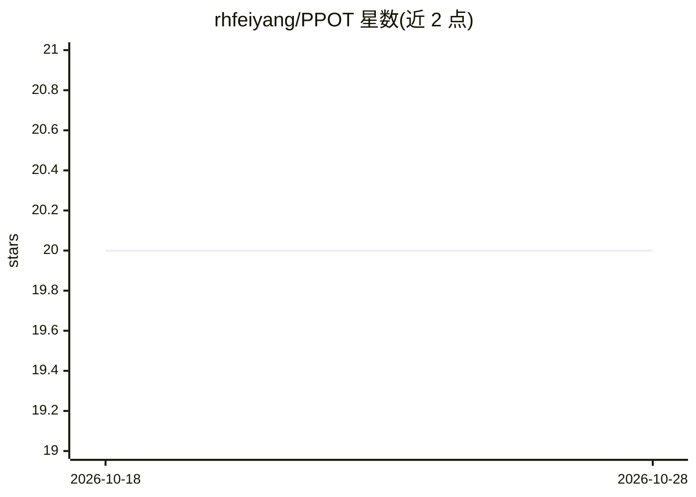

# rhfeiyang/PPOT

⭐ 20 · Python · NOASSERTION · 推送 2026-06-24 · [GitHub](https://github.com/rhfeiyang/PPOT) · 组织维护

**ICLR 2024 论文 P²OT 官方 PyTorch 实现：深度不平衡聚类**

论文《Progressive Partial Optimal Transport for Deep Imbalanced Clustering》（ICLR 2024）的官方代码库，基于 PyTorch 与渐进部分最优传输方法做不平衡数据的深度聚类。通过 git clone 与 conda 环境安装，需在 utils/mypath.py 中配置数据集路径；支持 CIFAR100、imagenet-r、iNaturalist18 数据集并自动构建不平衡版本，训练与评估均通过命令行脚本进行，支持多头聚类设置。许可证仅允许个人与科研使用，商业需联系作者。

## 筛选速览

| 维度 | 判定 | 备注 |
|---|---|---|
| AI 角色 | `ai-native` | 本体是模型或模型工具 |
| 许可风险 | `none` | NOASSERTION |
| 部署形态 | `None` |  |
| 模型依赖 | — | README 未给出锁定关系 |
| 硬件要求 | — | 无带数字的原话,不猜 |
| 安装摩擦 | `low` | 无编译、无系统依赖或容器化 |
| 成熟度 | — | 结构信号不足 |

## 能力要点

- 渐进部分最优传输（Progressive Partial Optimal Transport）方法实现
- 支持 CIFAR100、imagenet-r、iNaturalist18 不平衡数据集自动构建
- 支持多头聚类与 overclustering 配置

## 适用场景

- 复现论文中的不平衡聚类实验
- 在不平衡数据集上训练与评估深度聚类模型
- 作为不平衡聚类研究的方法参考实现

## 场景标签

 · 领域:机器学习/聚类

## 证据(README 行号)

> L1: # P 2 OT: Progressive Partial Optimal Transport for Deep Imbalanced Clustering
> L4: This repo contains the Pytorch implementation of our paper. (Accepted by ICLR 2024)

## 星数曲线

2026-10-18 20 → 2026-10-28 20（+0）

---
*卡片 v1 · prompt 1.4 · 生成 2026-10-28 · 置信度 high · 依据 README sha `e48512d30de5` · [字段定义](../../DATASET.md)*
