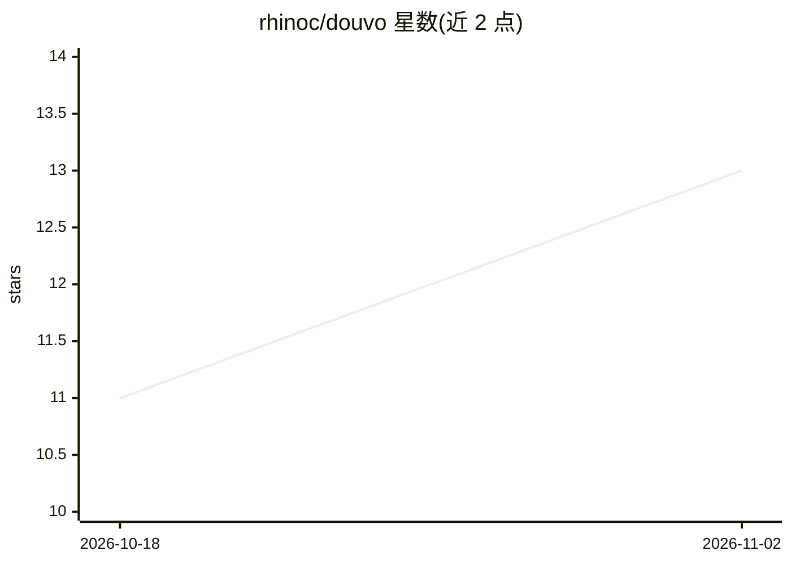

# rhinoc/douvo

⭐ 13 · Swift · MIT · 推送 2026-10-10 · [GitHub](https://github.com/rhinoc/douvo) · 个人维护 · 中文 README

**Apple Silicon macOS 菜单栏语音输入应用：ASR 转写加可选 AI 后处理**

面向 Apple Silicon Mac（macOS 14+）的语音听写应用：按键或按住说话，转写结果经清理后插入当前光标所在应用。支持四条 ASR 通道（豆包 Web/Android、有道巴掌说、Chatterfly），可多路并行并合并结果；这些通道依赖对客户端行为的逆向观察而非官方 API，服务方变更可能导致失效，需自行登录有效账号。AI 后处理可选本地 MLX 模型（内置 S1-mini、Spark-X2.5）或远程 LLM 提供方，支持词汇提示、选中文本编辑、按需翻译。提供 DMG 安装包与 Homebrew Cask，未公证。

## 筛选速览

| 维度 | 判定 | 备注 |
|---|---|---|
| AI 角色 | `ai-native` | 本体是模型或模型工具 |
| 许可风险 | `permissive` | MIT |
| 部署形态 | `desktop` | 安装包/桌面程序 |
| 模型依赖 | — | README 未给出锁定关系 |
| 硬件要求 | — | 无带数字的原话,不猜 |
| 安装摩擦 | `low` | 无编译、无系统依赖或容器化 |
| 成熟度 | — | 结构信号不足 |

## 能力要点

- 四条 ASR 通道（豆包 Web/Android、有道巴掌说、Chatterfly），可并行合并
- 本地 MLX 模型或远程 LLM 做转写后处理（纠错/标点/语气/风格）
- 语音编辑选中文本、录音中按键切换翻译模式
- 词汇提示与上下文（当前时间、前台应用、窗口标题）注入

## 适用场景

- 中英混输场景下向任意应用语音听写并自动清理转写
- 用语音指令改写已选中的文本而非整体替换
- 听写时按键切换，直接插入目标语言的翻译结果

## 场景标签

`语音识别` · 领域:感知与多模态

## 证据(README 行号)

> L4:  A lightweight macOS voice input app with multiple ASR providers and optional AI post-processing.
> L46: - ⚙️ **Choose local or remote AI** — Run MLX models on device, use a local model folder, or connect a remote LLM pr
> L83: Douvo supports four ASR paths: Doubao **Web**, Doubao **Android**, Youdao **Bage Shuo**, and **Chatterfly**. Select

## 星数曲线

2026-10-18 11 → 2026-11-02 13（+2）

---
*卡片 v1 · prompt 1.4 · 生成 2026-11-01 · 置信度 high · 依据 README sha `3b0b53d6a133` · [字段定义](../../DATASET.md)*
