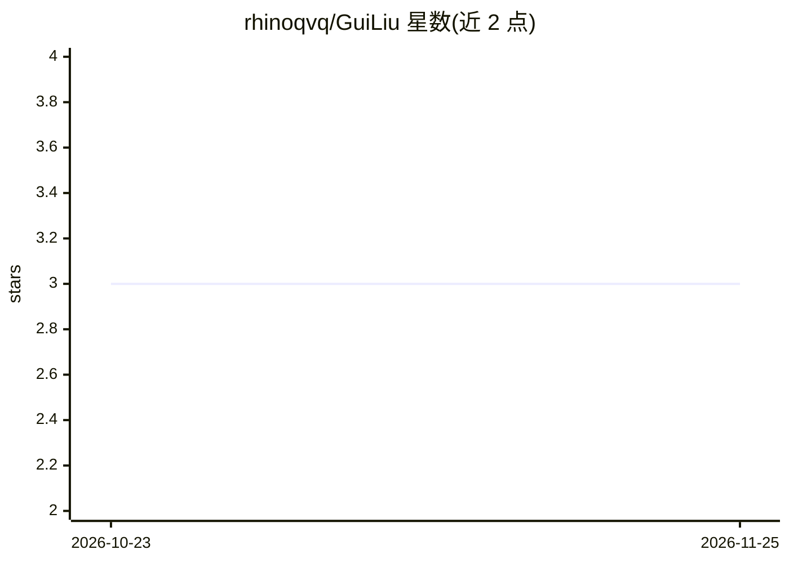

# rhinoqvq/GuiLiu

⭐ 3 · Python · MIT · 推送 2026-10-18 · [GitHub](https://github.com/rhinoqvq/GuiLiu) · 个人维护 · 中文 README

**本机运行的 AI 记账工具：邮件与小票自动入账并分析消费**

归流是在用户自己电脑上运行的记账与财务分析应用，分前端、后端（Python/FastAPI + SQLite）和 Agent 三个服务。它从 Gmail/163 银行通知邮件、邮箱收到的小票图片、支付宝/微信 CSV/Excel 账单中提取商户、金额与时间入账；模型负责解析不确定输入，本地代码负责规则验证、查重和余额计算。分析 Agent 支持自然语言问答与图表画布。分发形式为 Windows 便携压缩包（内置 Python 3.13 与 Node 22），目前只在 Windows 上完整验证。

## 筛选速览

| 维度 | 判定 | 备注 |
|---|---|---|
| AI 角色 | `ai-native` | 本体是模型或模型工具 |
| 许可风险 | `permissive` | MIT |
| 部署形态 | `desktop` | 安装包/桌面程序 |
| 模型依赖 | — | README 未给出锁定关系 |
| 硬件要求 | — | 无带数字的原话,不猜 |
| 安装摩擦 | `low` | 无编译、无系统依赖或容器化 |
| 成熟度 | `idea` | |

## 能力要点

- 银行通知解析规则由模型生成并在本地验证后按银行复用
- 明细补全（ADR）：在邮件与小票中找证据补全商品明细且不重复记账
- 数据留本机：三服务只监听本机地址，数据存 .runtime/ 目录
- 中文/日文/英文三语界面与多币种（日元/人民币）折算

## 适用场景

- 把银行通知邮件和小票截图自动整理成账本
- 用自然语言问这个月为什么花得多并拿到图表
- 导入支付宝/微信账单做预览式批量入账
- 设定储蓄目标并让 Agent 按周期执行自动分析

## 场景标签

`文档解析` `数据分析` · 领域:效率与自动化

## 证据(README 行号)

> L9: 归流是一个在你自己电脑上运行的 AI 记账与财务分析工具。名字来自贯穿整个项目的回环：你的每一次确认和修正都会流回系统，变成下次可以直接复用的规则和记忆。
> L13: 大部分 agent 都在后台工作。每个环节配了一个专门的 agent，由后端在对应环节直接调用：为新的银行通知写解析规则，联网核实商家后再分类，在邮件和小票里找证据补全商品明细。拿不准的时候，才把问题交给你确认。你能直接对话的是分
> L113: - 需要外部服务的环节：邮件读取（Google / 网易）、信息提取与对话（通义千问）、文本向量化（OpenAI）、Agent 联网搜索、汇率（ExchangeRate-API、Frankfurter）、检查新版本（GitHub

## 星数曲线

2026-10-23 3 → 2026-11-25 3（+0）

---
*卡片 v1 · prompt 1.4 · 生成 2026-11-21 · 置信度 mid · 依据 README sha `c49ac72b4047` · [字段定义](../../DATASET.md)*
