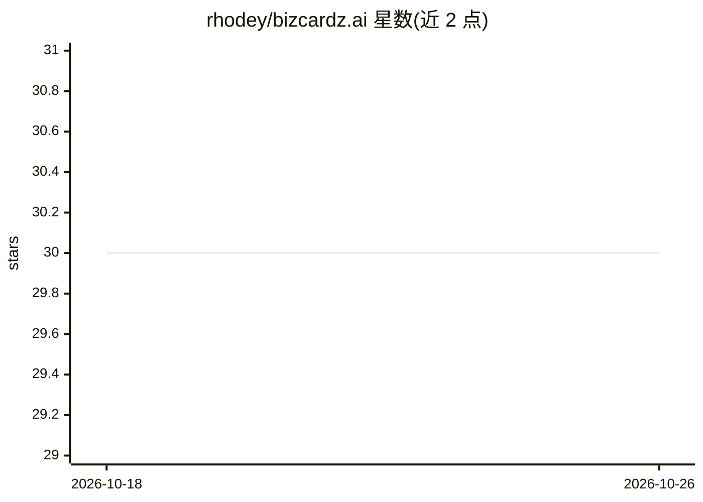

# rhodey/bizcardz.ai

⭐ 30 · JavaScript · 推送 2026-08-28 · [GitHub](https://github.com/rhodey/bizcardz.ai) · [官网](https://bizcardz.ai) · 个人维护

**在线设计金属名片并转为 KiCad PCB 图的网站**

一个托管在 GitHub 用于作品集展示的闭源网站项目：用户在网页上设计名片，系统将其转换为 KiCad PCB 原理图/布局，可交由 Elecrow、PCBWay 等 PCB 制造商以金属工艺生产实体名片。README 仅含项目简介、结果展示与许可声明，未公开源码、安装方式或技术细节，无法验证名片设计环节中 AI 的具体作用。

## 筛选速览

| 维度 | 判定 | 备注 |
|---|---|---|
| AI 角色 | `ai-enhanced` | 去掉 AI 部分产品仍成立 |
| 许可风险 | `none` | — |
| 部署形态 | `None` |  |
| 模型依赖 | — | README 未给出锁定关系 |
| 硬件要求 | — | 无带数字的原话,不猜 |
| 安装摩擦 | `low` | 无编译、无系统依赖或容器化 |
| 成熟度 | — | 结构信号不足 |

## 能力要点

- 名片设计转换为 KiCad PCB 文件
- 支持交由 Elecrow/PCBWay 等厂商以金属工艺制造
- 以网站形式提供设计到制造的流程

## 适用场景

- 设计并定制金属材质的个性化名片
- 获取可交给 PCB 制造商的生产文件

## 场景标签

 · 领域:创意硬件/PCB 制造

## 证据(README 行号)

> L2: bizcardz.ai is a website where you design business cards which are converted to KiCad PCB schematics which can be ma
> L11: This is a closed source project of mine which I keep on github for purposes of including in my portfolio.

## 星数曲线

2026-10-18 30 → 2026-10-26 30（+0）

---
*卡片 v1 · prompt 1.4 · 生成 2026-10-26 · 置信度 low · 依据 README sha `28dab122a307` · [字段定义](../../DATASET.md)*
