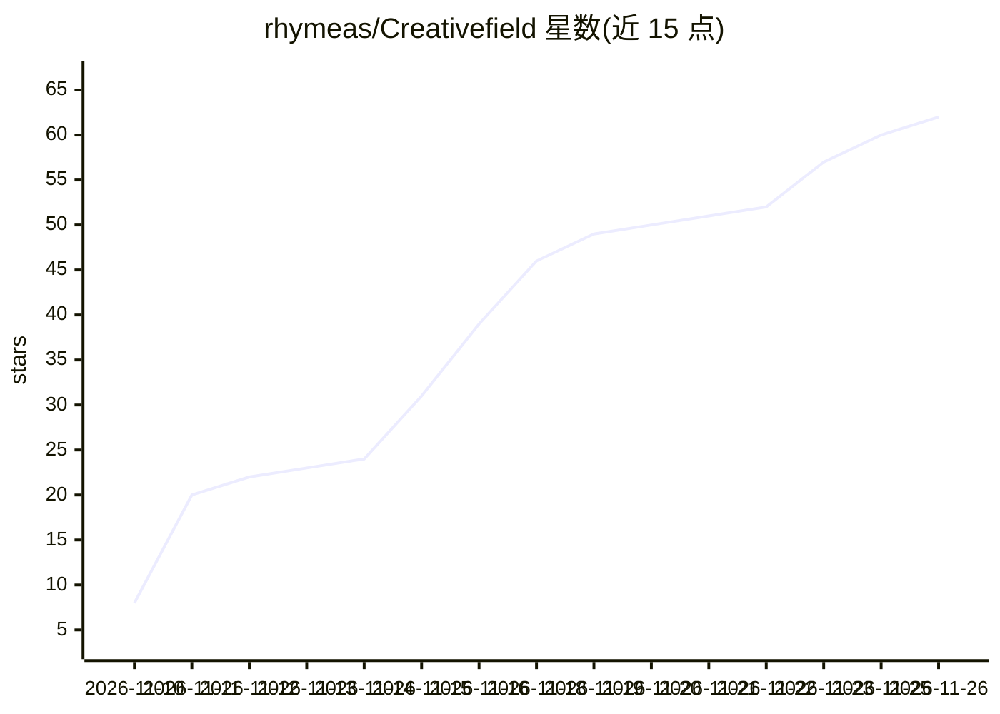

# rhymeas/Creativefield

⭐ 62 · TypeScript · GPL-3.0 · 推送 2026-11-21 · [GitHub](https://github.com/rhymeas/Creativefield) · [官网](https://www.creativefield.app) · 个人维护

**基于 ComfyUI 的本地图像/视频/3D 创作工作室**

在 ComfyUI 之上封装的开源创作应用：以任务菜单（建视频、改图、3D 等）组织预置工作流，本地默认由 HyperFlow H3 Flash（视频）、FLUX 3 Klein/Fibo 2.0/Qwen Image 2.1（图像）、Hunyuan3D 2.1（3D）等模型驱动；也可用自有 Comfy API key 经 Comfy Router 在线渲染（Seedance、Kling、FLUX Pro 等）。内含 FotoField 图层式 AI 照片编辑器（SAM 3.1 分割、AI 修改/消除/选区），官方 Comfy 工作流可转为应用内工具。要求 Windows 与 NVIDIA GPU，自称 early preview。GPL-3.0。

## 筛选速览

| 维度 | 判定 | 备注 |
|---|---|---|
| AI 角色 | `ai-native` | 本体是模型或模型工具 |
| 许可风险 | `viral` | GPL-3.0 |
| 部署形态 | `library` | 以包/库形式分发 |
| 模型依赖 | — | README 未给出锁定关系 |
| 硬件要求 | — | 无带数字的原话,不猜 |
| 安装摩擦 | `medium` | 含编译或系统依赖之一 |
| 成熟度 | `idea` | |

## 能力要点

- 视频/图像/3D 任务式界面，底层为 ComfyUI 工作流，可打开节点图
- FotoField 浏览器内图层编辑器，AI 选区/修改/消除经本机 ComfyUI 运行
- 本地优先，亦可凭自有 Comfy API key 在 Comfy Router 上在线渲染
- 官方 Comfy 模板可校验并转为菜单内应用（如 Z-Image Turbo、Hunyuan3D 2.1）

## 适用场景

- 在本机 GPU 上从文字或图片生成视频、图像与 3D 模型
- 做图层式照片编辑（选区、换背景、放大、局部重绘）
- 用时间线关键帧、灰块分镜转视频等方式做短片创作

## 场景标签

`图像生成` `视频生成` · 领域:内容生成

## 证据(README 行号)

> L17:  **A free, open-source creative studio on ComfyUI: video, pictures and 3D from a few words, plus FotoField, an AI p
> L19: **Try it online at creativefield.app** — every browser gets its own private try-out workspace. Your library stays i
> L115: **FotoField**, our image editor, has layers, masks, selections, smart objects, blend modes, crop, transform and br

## 星数曲线

2026-11-10 8 → 2026-11-26 62（+54）

---
*卡片 v1 · prompt 1.4 · 生成 2026-11-18 · 置信度 mid · 依据 README sha `c63801acb2b9` · [字段定义](../../DATASET.md)*
