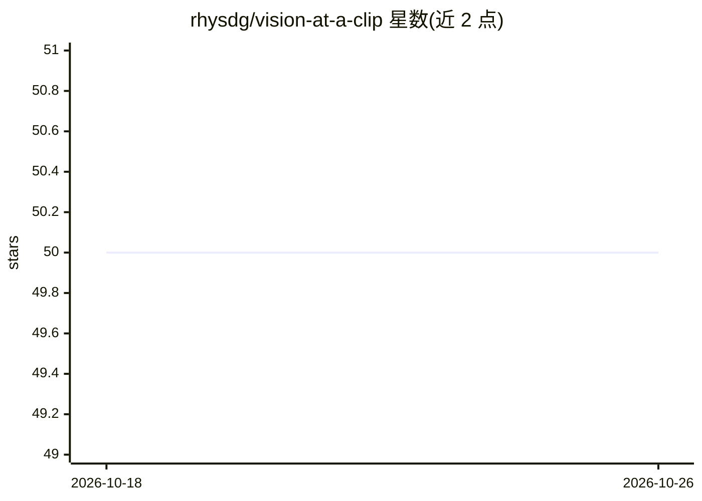

# rhysdg/vision-at-a-clip

⭐ 50 · Jupyter Notebook · 推送 2026-05-20 · [GitHub](https://github.com/rhysdg/vision-at-a-clip) · 个人维护

**面向开发者的 ONNX/TensorRT 版 CLIP/SigLIP/GroundingDINO/SAM 推理工具集**

以 Python 类与脚本形式提供的多模态基础模型部署工具集：将 CLIP ViT-B/32、SigLIP（FP16）、GroundingDINO（Swin-T + BERT 文本编码器）转换为 ONNX 表示并提供推理 API，另含 Segment Anything ONNX 类。支持零样本图像分类与目标检测，提供 cosine 相似度多上下文评估、hidden states 提取及 Gradio 示例应用（python3 app.py）。模型自动下载，目前通过 git clone 源码加 pip requirements 安装，Python 打包与 TensorRT 支持列为未来计划，延迟基准数据尚未填入。

## 筛选速览

| 维度 | 判定 | 备注 |
|---|---|---|
| AI 角色 | `ai-native` | 本体是模型或模型工具 |
| 许可风险 | `none` | — |
| 部署形态 | `library` | 以包/库形式分发 |
| 模型依赖 | — | README 未给出锁定关系 |
| 硬件要求 | — | 无带数字的原话,不猜 |
| 安装摩擦 | `medium` | 含编译或系统依赖之一 |
| 成熟度 | `idea` | |

## 能力要点

- CLIP/SigLIP/GroundingDINO 的 ONNX 转换与完整推理类（OnnxLip、OnnxSAM）
- 零样本分类与目标检测，模型自动下载
- 多上下文 cosine 相似度评估与 hidden states 提取
- Gradio 示例应用（python3 app.py 本地运行）

## 适用场景

- 用文本提示对图像做零样本分类或目标检测
- 以 SigLIP 单独或配合 SAM 做图像定位与标注
- 本地部署 ONNX 版多模态基础模型并接入自己的流程

## 场景标签

`多模态` `目标检测` · 领域:感知与多模态

## 证据(README 行号)

> L39: - GroundingDINO - Zero-shot object detection - Swin T based with a bert incased text encoder, converted to ONNX, FP

## 星数曲线

2026-10-18 50 → 2026-10-26 50（+0）

---
*卡片 v1 · prompt 1.4 · 生成 2026-10-24 · 置信度 mid · 依据 README sha `84e4814f08ef` · [字段定义](../../DATASET.md)*
