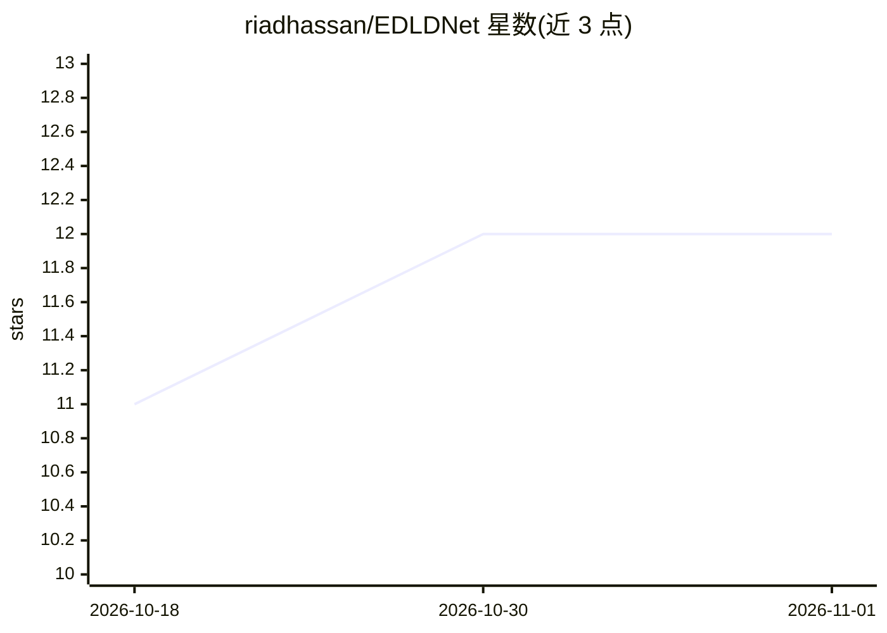

# riadhassan/EDLDNet

⭐ 12 · Python · MIT · 推送 2025-11-27 · [GitHub](https://github.com/riadhassan/EDLDNet) · 个人维护

**多器官医学图像分割网络 EDLDNet 的官方 PyTorch 实现**

论文《Efficient Dual-line Decoder with Multi-Scale Convolutional Attention for Multi Organ segmentation》（发表于 Biomedical Signal Processing and Control）的官方 PyTorch 实现仓库。面向科研人员，提供在 Synapse 多器官数据集上的训练与测试脚本、预训练 PVTv2 初始化权重下载说明与已训练模型权重；环境为 Python 3.8 + PyTorch 1.11.0+cu113。数据集需从 Synapse 官网注册下载并预处理，或下载预处理版数据。

## 筛选速览

| 维度 | 判定 | 备注 |
|---|---|---|
| AI 角色 | `ai-native` | 本体是模型或模型工具 |
| 许可风险 | `permissive` | MIT |
| 部署形态 | `library` | 以包/库形式分发 |
| 模型依赖 | — | README 未给出锁定关系 |
| 硬件要求 | — | 无带数字的原话,不猜 |
| 安装摩擦 | `medium` | 含编译或系统依赖之一 |
| 成熟度 | — | 结构信号不足 |

## 能力要点

- 双行解码器与多尺度卷积注意力的分割网络实现
- 提供 Synapse 数据集的训练（train_synapse.py）与测试（test_synapse.py）脚本
- 说明 PVTv2 预训练权重初始化与数据处理流程

## 适用场景

- 复现论文中的多器官分割实验
- 在 Synapse 数据集上训练/测试分割模型
- 基于该架构做医学图像分割研究改进

## 场景标签

`目标检测` · 领域:感知与多模态

## 证据(README 行号)

> L1: # EDLDNet
> L2: Official pytorch implementation of **Efficient Dual-line Decoder with Multi-Scale Convolutional Attention for Multi 

## 星数曲线

2026-10-18 11 → 2026-11-01 12（+1）

---
*卡片 v1 · prompt 1.4 · 生成 2026-11-01 · 置信度 high · 依据 README sha `05c992aa41d3` · [字段定义](../../DATASET.md)*
