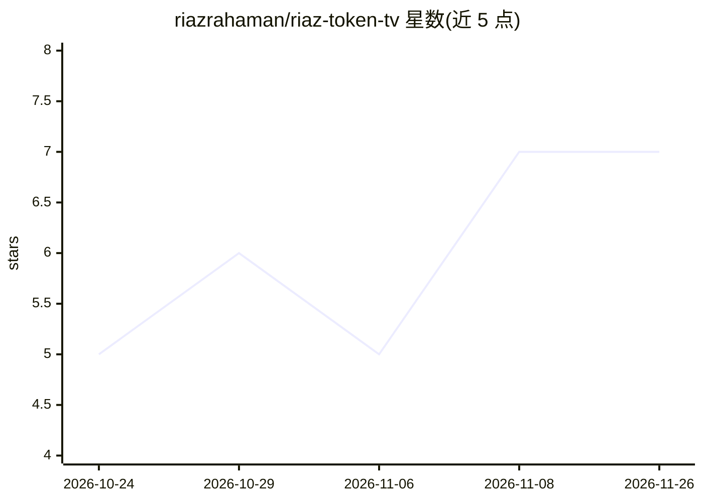

# riazrahaman/riaz-token-tv

⭐ 7 · Python · MIT · 推送 2026-10-26 · [GitHub](https://github.com/riazrahaman/riaz-token-tv) · [官网](https://github.com/riazrahaman/riaz-token-tv#readme) · 个人维护

**把 AI 用量配额与行情显示在廉价 WiFi 桌面钟上的主机端工具**

在主机端运行 Python 程序，读取本地 CLI 会话与 API 凭证，提取 Claude、ChatGPT、Ollama Cloud、Antigravity 的会话/周/月配额遥测，与美股/印度股市行情、Apple Calendar 日程、2028 倒计时合成 240×240 GIF/JPEG，通过 HTTP 上传到 ESP8266/ST7789 桌面钟，无需刷固件。支持 npx/uvx 免安装 demo、pipx 本地安装、本地 Web 仪表盘与 JSON 端点供移动小组件使用。

## 筛选速览

| 维度 | 判定 | 备注 |
|---|---|---|
| AI 角色 | `ai-ecosystem` | LLM/agent 周边工具 |
| 许可风险 | `permissive` | MIT |
| 部署形态 | `library` | 以包/库形式分发 |
| 模型依赖 | local-ok | 支持本地模型 |
| 硬件要求 | — | 无带数字的原话,不猜 |
| 安装摩擦 | `low` | 无编译、无系统依赖或容器化 |
| 成熟度 | — | 结构信号不足 |

## 能力要点

- 无需刷固件，主机端合成画面经 HTTP 照片模式推送
- 读取 macOS Keychain/本地文件获取 Claude、ChatGPT、Ollama Cloud、Antigravity 配额
- 美股 Finnhub 与印度 NSE/BSE 跟日行情轮播
- 本地 REST API 输出 JSON 遥测供 Apple Watch/移动小组件

## 适用场景

- 在桌面钟上实时查看各 AI 服务的会话与周配额余量
- 跟踪美股与印度股市的开盘时段行情
- 把 2028 目标倒计时与日程显示在桌面上

## 场景标签

 · 领域:硬件 gadget/AI 用量监控

## 证据(README 行号)

> L5: Host-side composited 240×240 pixel art, live session & weekly quotas (Claude, ChatGPT, Ollama Cloud, Antigravity), f
> L174: |Provider|Telemetry Extracted|Credential Discovery|
> L176: |**Anthropic Claude**|5H session quota %, 7-day weekly quota %, reset countdowns|macOS Keychain (`Claude Code-cred

## 星数曲线

2026-10-24 5 → 2026-11-26 7（+2）

---
*卡片 v1 · prompt 1.4 · 生成 2026-11-20 · 置信度 high · 依据 README sha `5ab5391f1a30` · [字段定义](../../DATASET.md)*
