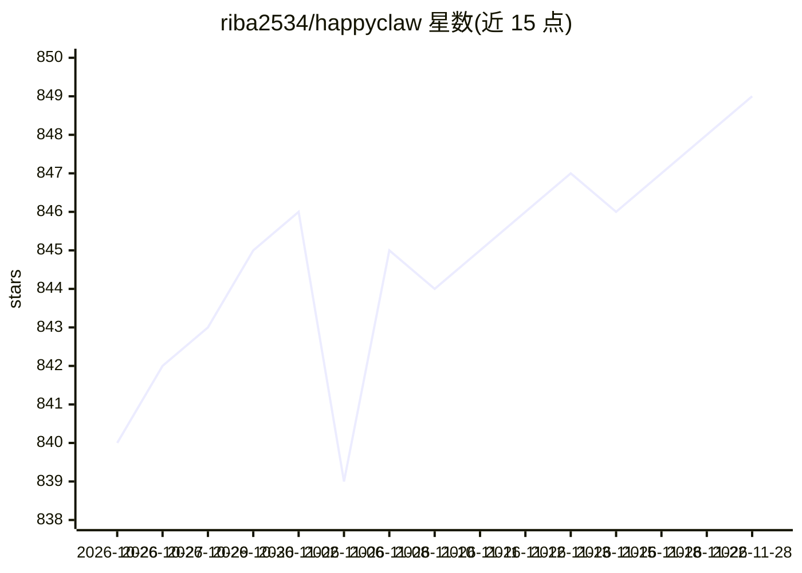

# riba2534/happyclaw

⭐ 849 · TypeScript · MIT · 推送 2026-11-20 · [GitHub](https://github.com/riba2534/happyclaw) · [官网](https://happyclaw.cc/) · 个人维护 · 中文 README

**让 Claude Code 通过 Web 与 8 种消息渠道长期在线的自托管多用户工作台**

基于 Claude Agent SDK for TypeScript 的自托管 AI 智能体系统，把 Claude Code 运行时封装为可持续运行的多用户服务。智能体运行在真实 Claude Code 环境中，可读写文件、执行终端命令、调用 MCP、加载 Skills，支持飞书/Telegram/QQ/钉钉/微信/Discord 等 8 种 IM 渠道与 Web 统一接入。采用智能体→工作区→会话层级隔离权限与上下文，支持宿主机与 Docker 沙箱双执行模式、自动化计划任务、Workspace Memory、用量统计与备份。通过 git clone 与 make start 部署，需 Node.js 22+。

## 筛选速览

| 维度 | 判定 | 备注 |
|---|---|---|
| AI 角色 | `ai-ecosystem` | LLM/agent 周边工具 |
| 许可风险 | `permissive` | MIT |
| 部署形态 | `self-host` | docker 或自建部署 |
| 模型依赖 | locked-api |  |
| 硬件要求 | — | 无带数字的原话,不猜 |
| 安装摩擦 | `low` | 无编译、无系统依赖或容器化 |
| 成熟度 | — | 结构信号不足 |

## 能力要点

- 封装版本锁定的 Claude Agent SDK 与 Claude Code CLI，不重新实现运行循环
- 8 种 IM 渠道与 Web/PWA 统一接入，渠道会话显式绑定工作区/会话
- 宿主机与 Docker 沙箱双执行模式，多用户权限与工作区隔离
- 自动化按计划在真实会话运行，支持停止条件、安静模式与失败去重通知

## 适用场景

- 在飞书、Telegram 等聊天工具里长期使用同一套 Claude Code 智能体
- 团队自托管多用户 Agent 服务，普通成员在容器沙箱中隔离执行
- 定时让 Agent 自动执行检查任务并把结果推回消息渠道

## 场景标签

`编码 Agent` `AI 助手` · 领域:编码与开发

## 证据(README 行号)

> L34: HappyClaw 是一个基于 Claude Agent SDK for TypeScript 的自托管 AI 智能体系统。它把完整的 Claude Code 运行时封装成一个可持续运行的多用户服务，让你可以从浏览器、飞书、Tel
> L40: - **Claude Code 原生运行时** — 直接使用版本锁定的 Claude Agent SDK 与 Claude Code CLI，不重新实现工具调用和运行循环。
> L41: - **智能体优先工作台** — 智能体管身份和能力，工作区管文件与执行环境，会话管对话上下文，产品层级清晰。

## 星数曲线

2026-10-26 840 → 2026-11-28 849（+9）

---
*卡片 v1 · prompt 1.4 · 生成 2026-11-24 · 置信度 high · 依据 README sha `b0e22150246f` · [字段定义](../../DATASET.md)*
