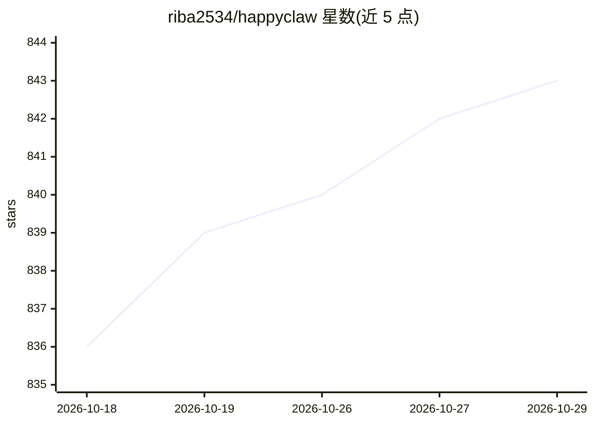

# riba2534/happyclaw

⭐ 843 · TypeScript · MIT · 推送 2026-10-28 · [GitHub](https://github.com/riba2534/happyclaw) · [官网](https://happyclaw.cc/) · 个人维护 · 中文 README

**自托管多用户的 Claude Code 智能体工作台，接入 8 种 IM 渠道**

基于 Claude Agent SDK for TypeScript 的自托管 AI 智能体系统，把 Claude Code 运行时封装为持续运行的多用户服务。用户通过 Web/PWA 或飞书、Telegram、QQ、钉钉、微信、企业微信、Discord、WhatsApp 八种渠道使用同一套智能体、工作区与自动化任务；智能体可读写文件、执行命令、用浏览器、调用 MCP 与加载 Skills。支持宿主机与 Docker 沙箱双执行模式、多 Provider 负载均衡（轮询/加权/故障转移）、Cron 定时任务、Workspace Memory、用量统计与 RBAC。macOS/Linux 运行，Windows 需 WSL2，需 Node.js 20+。

## 筛选速览

| 维度 | 判定 | 备注 |
|---|---|---|
| AI 角色 | `ai-ecosystem` | LLM/agent 周边工具 |
| 许可风险 | `permissive` | MIT |
| 部署形态 | `self-host` | docker 或自建部署 |
| 模型依赖 | locked-api |  |
| 硬件要求 | — | 无带数字的原话,不猜 |
| 安装摩擦 | `low` | 无编译、无系统依赖或容器化 |
| 成熟度 | — | 结构信号不足 |

## 能力要点

- 封装 Claude Code 运行时为多用户长驻服务，Web + 8 种 IM 渠道统一接入
- 宿主机 / 非 root Docker 沙箱双执行模式，权限按用户与工作区隔离
- 多 Claude Provider 配置与轮询/加权/故障转移负载均衡、会话粘性
- 定时任务（Cron/间隔/一次性）、Workspace Memory、用量统计与审计日志

## 适用场景

- 团队自托管一个长期在线的 Claude Code 智能体平台
- 在飞书/Telegram/QQ 等 IM 中直接使用和操控自己的智能体
- 为智能体任务配置定时调度与隔离执行环境

## 场景标签

`编码 Agent` · 领域:编码与开发

## 证据(README 行号)

> L35: HappyClaw 是一个基于 Claude Agent SDK for TypeScript 的自托管 AI 智能体系统。它把完整的 Claude Code 运行时封装成一个可持续运行的多用户服务，让你可以从浏览器、飞书、Tel
> L41: - **Claude Code 原生运行时** — 直接使用版本锁定的 Claude Agent SDK 与 Claude Code CLI，不重新实现工具调用和运行循环。

## 星数曲线

2026-10-18 836 → 2026-10-29 843（+7）

---
*卡片 v1 · prompt 1.4 · 生成 2026-10-21 · 置信度 mid · 依据 README sha `5a18f5335467` · [字段定义](../../DATASET.md)*
