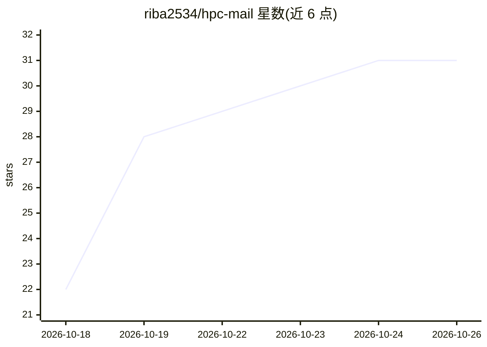

# riba2534/hpc-mail

⭐ 31 · TypeScript · MIT · 推送 2026-10-22 · [GitHub](https://github.com/riba2534/hpc-mail) · [官网](https://hpc.email) · 个人维护 · 中文 README

**跑在 Cloudflare Workers 上的多域名多用户邮箱系统，AI Agent 可直接收发邮件**

完全运行在 Cloudflare 上的邮箱系统：Email Routing 做 catch-all 收件（任意前缀地址即收即用、无需预建），Workers 处理，D1/KV/R2 存储，无传统 SMTP 服务器与 VPS。支持多域名多用户、地址认领制、回复/转发/附件、站内互投；外发任意外部地址需 Workers Paid 计划。验证码用正则同步提取，可选接入 OpenAI 兼容接口（如 DeepSeek）做兜底识别与邮件翻译。全套能力通过网页与开放 REST API 提供，站点根路径带 /skill.md 与 OpenAPI 3.1 描述，供 Claude/GPT 等 Agent 凭账号自行收发邮件、读验证码。面向希望零服务器自建邮箱并让 AI 代收邮件的个人开发者。限制：本地开发宿主机需 glibc ≥ 2.32；R2 开通需绑定支付方式。

## 筛选速览

| 维度 | 判定 | 备注 |
|---|---|---|
| AI 角色 | `ai-enhanced` | 去掉 AI 部分产品仍成立 |
| 许可风险 | `permissive` | MIT |
| 部署形态 | `library` | 以包/库形式分发 |
| 模型依赖 | — | README 未给出锁定关系 |
| 硬件要求 | — | 无带数字的原话,不猜 |
| 安装摩擦 | `low` | 无编译、无系统依赖或容器化 |
| 成熟度 | — | 结构信号不足 |

## 能力要点

- 多域名 catch-all 收件，任意前缀地址即收即用，无需预建
- 验证码正则同步提取 + 可选 OpenAI 兼容大模型（如 DeepSeek）兜底识别
- /skill.md 与 /v1/openapi.json 供 AI Agent 凭账号自行完成收发与读验证码全流程
- 开放 REST API：API Key 支持 scope、限流、IP 白名单、调用审计

## 适用场景

- 注册网站时现编临时邮箱地址接验证码，不需要预建邮箱
- 让 Claude/GPT 等 Agent 拿到账号后替我收发邮件、读验证码
- 零服务器自建多域名邮箱，日常用量落在 Cloudflare 免费额度内

## 场景标签

 · 领域:邮箱/Serverless 应用

## 证据(README 行号)

> L28: HPC Mail 是一个完全跑在 Cloudflare 上的邮箱系统。它用 **Email Routing（收件）+ Workers（处理）+ D1 / KV / R2（存储）** 组合出，可选接入一个 OpenAI 兼容大模型（
> L30: 把任意多个域名的 catch-all 指向它，**任何前缀的地址都即收即用**：`abc@your-domain.com`、`x123@another.com` 不需要预先创建，来信全部落库。用户「认领」一个地址后即可用它收发；系
> L63: 这是 HPC Mail 与传统 webmail 最大的差异点：它把「让 AI 替你收发邮件」当成一等公民。

## 星数曲线

2026-10-18 22 → 2026-10-26 31（+9）

---
*卡片 v1 · prompt 1.4 · 生成 2026-10-26 · 置信度 mid · 依据 README sha `028396f0fbb2` · [字段定义](../../DATASET.md)*
