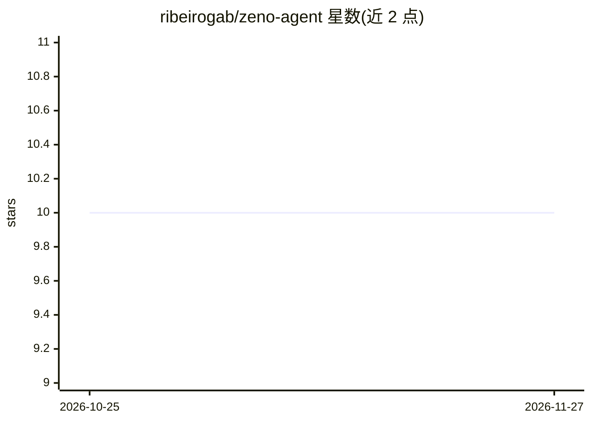

# ribeirogab/zeno-agent

⭐ 10 · TypeScript · MIT · 推送 2026-05-22 · [GitHub](https://github.com/ribeirogab/zeno-agent) · [官网](https://zeno-agent.dev) · 个人维护

**自托管单用户个人代理：通过连接器在既有应用中代为执行操作**

自托管、单用户的个人代理（agent）：核心机制是 MCP 连接器——每个连接器是一个通过仪表盘安装的小型 MCP 服务器，用户安装对应应用（GitHub、Linear、Sentry、Klaviyo 等）的连接器后，Zeno 可在 Slack 中代为执行修复 Sentry 报错后开 PR、整理收件箱、评论代码审查结果等操作。技能以 SKILL.md 说明书形式安装并被 Claude Agent SDK 自动发现，支持多 profile 隔离（容器、SQLite、主密钥）、按工具的 allow/ask/off 权限门控与定时任务。当前无多用户支持与托管实例。

## 筛选速览

| 维度 | 判定 | 备注 |
|---|---|---|
| AI 角色 | `ai-native` | 本体是模型或模型工具 |
| 许可风险 | `permissive` | MIT |
| 部署形态 | `None` |  |
| 模型依赖 | locked-api |  |
| 硬件要求 | — | 无带数字的原话,不猜 |
| 安装摩擦 | `low` | 无编译、无系统依赖或容器化 |
| 成熟度 | `idea` | |

## 能力要点

- 连接器为 MCP 服务器，通过仪表盘安装接入外部应用
- SKILL.md 技能说明书被 Claude Agent SDK 自动发现，能力按 profile 全局门控
- 多 profile 隔离：每个 profile 独立容器、仪表盘与主密钥
- 支持定时任务（crons）并保留每次运行历史

## 适用场景

- 在 Slack 中 @zeno 让代理代为整理收件箱或列出阻塞 issue
- 修复 Sentry 报错后自动开启 pull request
- 定时运行代理任务并查看运行历史

## 场景标签

`AI 助手` `工作流自动化` · 领域:效率与自动化

## 证据(README 行号)

> L3: > Personal agent that operates across the apps you use, by composing the connectors you install. Self-hosted. Single
> L14: Zeno acts on your behalf inside the apps you already work in. Open a pull request after fixing a Sentry error. Tria
> L28: - **Skills:** Markdown SKILL.md playbooks installed via the dashboard, materialized into `~/.claude/skills/`, auto-

## 星数曲线

2026-10-25 10 → 2026-11-27 10（+0）

---
*卡片 v1 · prompt 1.4 · 生成 2026-11-19 · 置信度 high · 依据 README sha `0ecfede14720` · [字段定义](../../DATASET.md)*
