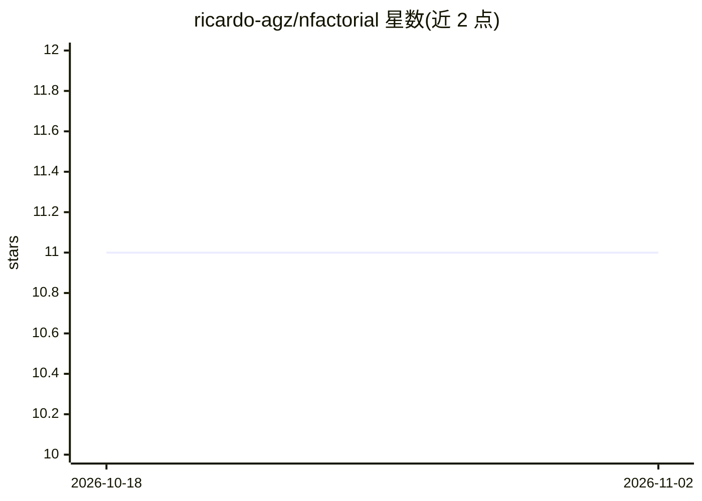

# ricardo-agz/nfactorial

⭐ 11 · Python · 推送 2026-05-04 · [GitHub](https://github.com/ricardo-agz/nfactorial) · [官网](https://factorial.sh) · 个人维护

**构建可派生子代理的分布式 Agent 框架**

Python 编写的 agent 框架，核心是 Redis 后端的编排器（Orchestrator），支持本地直接运行或分布式队列执行。提供自动重试、退避策略、崩溃 worker 任务恢复、运行中任务的取消/转向/唤醒/分支、子代理生成与多种等待机制（sleep/活动/信号/审批钩子）、代理间消息通信，以及内置指标仪表盘和日志。示例覆盖 IDE 编码代理、多代理、群聊与游戏代理等场景。

## 筛选速览

| 维度 | 判定 | 备注 |
|---|---|---|
| AI 角色 | `ai-ecosystem` | LLM/agent 周边工具 |
| 许可风险 | `none` | — |
| 部署形态 | `library` | 以包/库形式分发 |
| 模型依赖 | — | README 未给出锁定关系 |
| 硬件要求 | — | 无带数字的原话,不猜 |
| 安装摩擦 | `low` | 无编译、无系统依赖或容器化 |
| 成熟度 | — | 结构信号不足 |

## 能力要点

- Redis 后端分布式运行时与任务队列
- 自动重试、退避与崩溃 worker 任务恢复
- 运行中任务管理：取消、转向、唤醒、分支
- 子代理生成与审批钩子等等待机制

## 适用场景

- 搭建需要多代理协作与消息通信的系统
- 将 agent 任务分发到分布式 worker 上可靠执行
- 需要人工审批钩子的长时任务流程

## 场景标签

`Agent 框架` `多智能体` · 领域:Agent 开发

## 证据(README 行号)

> L5: nFactorial is an agent framework with a Redis-backed orchestrator for reliable multi-agent systems. It makes the fol
> L7: * **Direct and queued execution**: Run agents locally with `agent.run(...)` or on a distributed Redis-backed runtime

## 星数曲线

2026-10-18 11 → 2026-11-02 11（+0）

---
*卡片 v1 · prompt 1.4 · 生成 2026-11-01 · 置信度 high · 依据 README sha `79359cbc1b51` · [字段定义](../../DATASET.md)*
