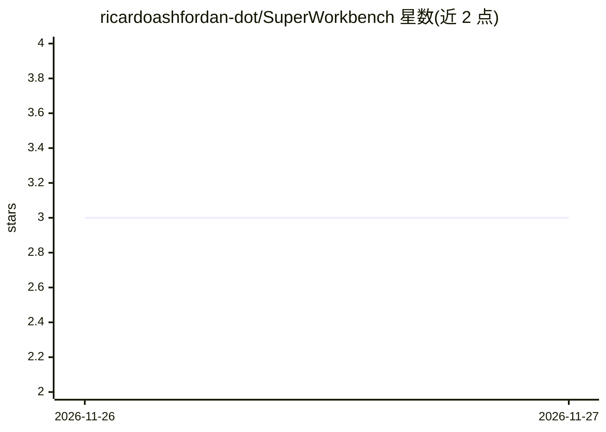

# ricardoashfordan-dot/SuperWorkbench

⭐ 3 · Python · MIT · 推送 2026-11-25 · [GitHub](https://github.com/ricardoashfordan-dot/SuperWorkbench) · 个人维护 · 中文 README

**本地多智能体编排工作室：统一调度本地 AI CLI 与 API**

纯 Python 标准库后端加单文件 HTML/CSS/JS 前端的多智能体编排界面，将 Antigravity、Codex、Claude Code、Gemini CLI 等本地 CLI 与 Ollama、OpenAI 兼容 API 汇聚到一个本地工作台。提供按工作区隔离的角色名单、5 种场景切换、流式输出、可视化 MCP 管理与 9 个内置技能，运行于 localhost，附会话令牌鉴权与 Host/Origin 校验。适合付费订阅了多个本地 AI CLI、希望在真实项目目录内组合使用它们的开发者。

## 筛选速览

| 维度 | 判定 | 备注 |
|---|---|---|
| AI 角色 | `ai-ecosystem` | LLM/agent 周边工具 |
| 许可风险 | `permissive` | MIT |
| 部署形态 | `library` | 以包/库形式分发 |
| 模型依赖 | local-ok | 支持本地模型 |
| 硬件要求 | — | 无带数字的原话,不猜 |
| 安装摩擦 | `low` | 无编译、无系统依赖或容器化 |
| 成熟度 | — | 结构信号不足 |

## 能力要点

- 零额外依赖：Python 3 标准库后端 + 单文件前端，无需 Docker/数据库
- 编排多个本地 AI CLI（agy/codex/claude/gemini/DSH）与 Ollama、OpenAI 兼容 API
- 可视化 MCP 管理器与 9 个内置技能，支持从 GitHub 导入技能
- 本地会话令牌鉴权、严格绑定 127.0.0.1，状态数据隔离在 .workbench/

## 适用场景

- 在真实项目目录里做多智能体编码与代码评审
- 组合已付费的本地 CLI 订阅与本地 Ollama 模型协作
- 搭建 AIGC 资产产出流水线（脚本到成片 5 阶段里程碑）

## 场景标签

`多智能体` `编码 Agent` `代码审查` · 领域:Agent 开发

## 证据(README 行号)

> L18: Orchestrate your local AI CLIs (**Antigravity `agy`**, **OpenAI `codex`**, **Claude Code `claude`**, **Gemini CLI `
> L26: - **Zero Extra Dependencies**: Pure Python 3 standard library backend + single-file HTML/CSS/JS frontend. No Docker
> L40:  - **Roles & BYO Engines**: Auto-discovers installed CLIs & local Codex models with `--doctor` version probes, plus

## 星数曲线

2026-11-26 3 → 2026-11-27 3（+0）

---
*卡片 v1 · prompt 1.4 · 生成 2026-11-26 · 置信度 mid · 依据 README sha `a0116a8de29a` · [字段定义](../../DATASET.md)*
