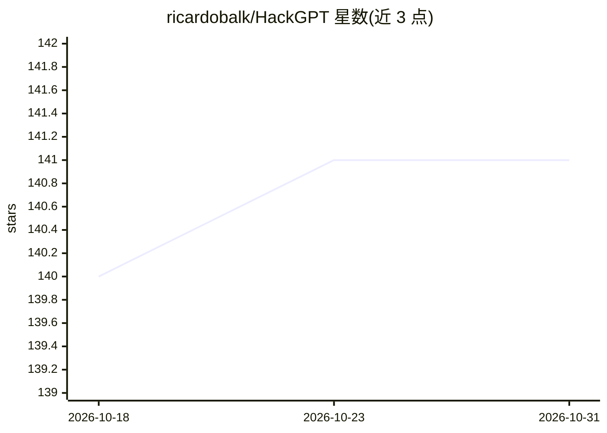

# ricardobalk/HackGPT

⭐ 141 · Python · ISC · 推送 2026-07-31 · [GitHub](https://github.com/ricardobalk/HackGPT) · 个人维护

**面向开发者的 ChatGPT 风格网页聊天界面**

基于 Python 3.9 与 Streamlit 构建的聊天界面，通过 OpenAI API 提供 GPT-3/GPT-4 等模型的对话，支持流式输出与打字效果开关。侧边栏可切换模型、调整响应参数与 API 配置，内置并可自定义 set-up 提示词，还支持为 GPT-4 设置知识截止日期。部署方式包括 Docker Compose、手动 Docker 与本地 Python 环境三种，许可证为 ISC。

## 筛选速览

| 维度 | 判定 | 备注 |
|---|---|---|
| AI 角色 | `ai-native` | 本体是模型或模型工具 |
| 许可风险 | `permissive` | ISC |
| 部署形态 | `self-host` | docker 或自建部署 |
| 模型依赖 | — | README 未给出锁定关系 |
| 硬件要求 | — | 无带数字的原话,不猜 |
| 安装摩擦 | `low` | 无编译、无系统依赖或容器化 |
| 成熟度 | `idea` | |

## 能力要点

- 流式输出与可开关的打字效果
- 侧边栏切换 GPT-3/GPT-4 等模型并调整响应参数
- 内置与自定义 set-up 提示词
- GPT-4 知识截止日期设置

## 适用场景

- 通过网页界面与 OpenAI 模型对话并调试参数
- 用不同 set-up 提示词对比模型回答
- 本地或容器化部署一个可定制的聊天前端

## 场景标签

`聊天机器人` · 领域:对话与助手

## 证据(README 行号)

> L3: Welcome to HackGPT, a powerful and customizable AI chatbot interface designed specifically for developers. With a Ch
> L11: - **Fine-tuning**: Tailor your HackGPT experience with the sidebar's range of options. Choose from different models

## 星数曲线

2026-10-18 140 → 2026-10-31 141（+1）

---
*卡片 v1 · prompt 1.4 · 生成 2026-10-22 · 置信度 mid · 依据 README sha `4e7554949062` · [字段定义](../../DATASET.md)*
