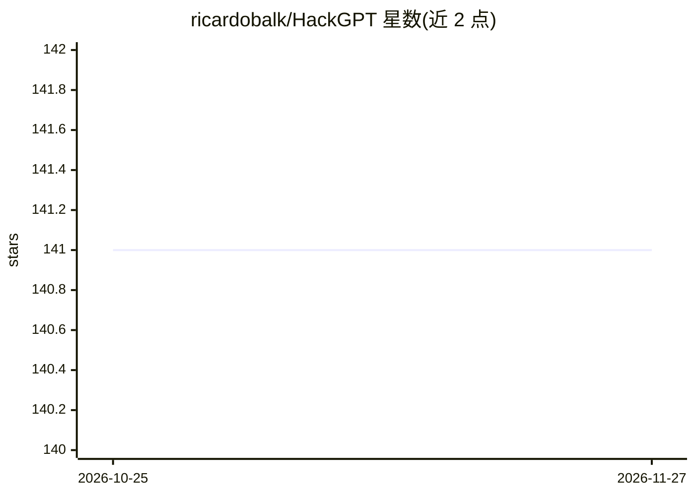

# ricardobalk/HackGPT

⭐ 141 · Python · ISC · 推送 2026-11-06 · [GitHub](https://github.com/ricardobalk/HackGPT) · 个人维护

**面向开发者的多提供商聊天界面，统一接入 OpenAI/Anthropic/Ollama**

基于 Streamlit 的聊天界面，核心机制是提供商中立的适配器架构：通过动态模型发现（/models 端点与 Ollama 主机）填充模型选择器，每个模型携带类型化选项 schema，不支持的控件不会发送给提供商；所有适配器流式输出，切换提供商时保留对话历史与系统提示。凭证仅从环境变量读取，不在界面中输入或显示。要求 Python 3.12+，提供 Docker Compose、本地 pip 安装与 VS Code Dev Container 三种启动方式。

## 筛选速览

| 维度 | 判定 | 备注 |
|---|---|---|
| AI 角色 | `ai-ecosystem` | LLM/agent 周边工具 |
| 许可风险 | `permissive` | ISC |
| 部署形态 | `self-host` | docker 或自建部署 |
| 模型依赖 | local-ok | 支持本地模型 |
| 硬件要求 | — | 无带数字的原话,不猜 |
| 安装摩擦 | `low` | 无编译、无系统依赖或容器化 |
| 成熟度 | — | 结构信号不足 |

## 能力要点

- OpenAI/Anthropic/Ollama 三类适配器，切换提供商不改界面
- schema 驱动的生成参数配置，含条件字段与默认值/范围
- 支持 LiteLLM 别名与 Azure 部署名的显式模型映射
- 凭证仅经环境变量配置，界面不展示

## 适用场景

- 在同一界面里切换不同提供商的模型做对话开发
- 通过自建网关（LiteLLM/Azure）接入团队内部模型部署
- 本地调试流式聊天与系统提示配置

## 场景标签

`聊天机器人` · 领域:对话与助手

## 证据(README 行号)

> L3: HackGPT is a Streamlit chat interface with provider-neutral model discovery,
> L10: - **Multiple providers**: Use OpenAI, Anthropic Claude, or Ollama without changing
> L175: - `src/hackgpt/providers/` — isolated OpenAI, Anthropic, and Ollama adapters plus the

## 星数曲线

2026-10-25 141 → 2026-11-27 141（+0）

---
*卡片 v1 · prompt 1.4 · 生成 2026-11-27 · 置信度 high · 依据 README sha `2d09f62737c3` · [字段定义](../../DATASET.md)*
