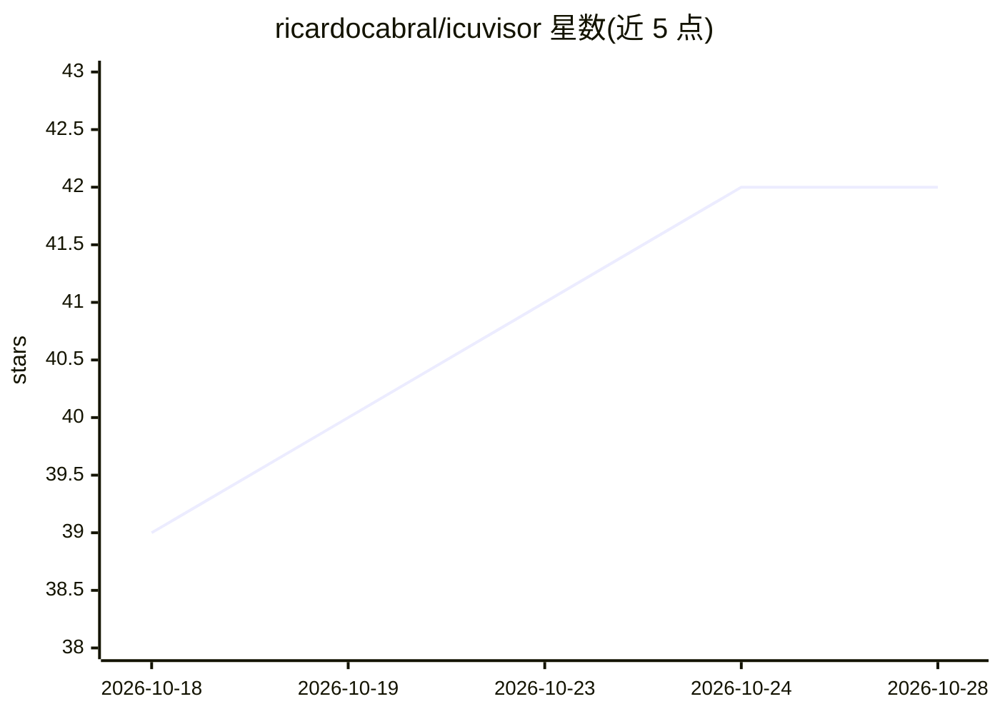

# ricardocabral/icuvisor

⭐ 42 · Go · MIT · 推送 2026-10-27 · [GitHub](https://github.com/ricardocabral/icuvisor) · [官网](https://icuvisor.app/) · 个人维护

**连接 AI 客户端与 intervals.icu 训练数据的本地 MCP 服务器**

用 Go 编写的开源 Model Context Protocol（MCP）服务器，面向 intervals.icu 运动训练平台的用户：在本地运行签名二进制文件，使 MCP 兼容的 AI 客户端可读取训练数据，API key 不进入聊天内容；如客户端需要公网 HTTPS 端点，可改用可选的托管连接器。文档覆盖本地与托管两种模式、隐私、安全模式、支持的客户端、故障排除与完整工具参考，并附 Cookbook 提示词示例。采用 MIT 许可证。

## 筛选速览

| 维度 | 判定 | 备注 |
|---|---|---|
| AI 角色 | `ai-ecosystem` | LLM/agent 周边工具 |
| 许可风险 | `permissive` | MIT |
| 部署形态 | `None` |  |
| 模型依赖 | — | README 未给出锁定关系 |
| 硬件要求 | — | 无带数字的原话,不猜 |
| 安装摩擦 | `low` | 无编译、无系统依赖或容器化 |
| 成熟度 | — | 结构信号不足 |

## 能力要点

- 本地优先运行签名二进制，API key 不经过聊天通道
- 支持 MCP 兼容 AI 客户端访问 intervals.icu 训练数据
- 提供可选托管连接器适配需要 HTTPS 端点的客户端
- 文档含 Cookbook、安全模式与工具参考

## 适用场景

- 让 AI 客户端分析我的 intervals.icu 训练数据
- 在不泄露 API key 的前提下用聊天客户端查询训练记录
- 需要公网端点时通过托管连接器接入

## 场景标签

 · 领域:运动健康/LLM 工具接入

## 证据(README 行号)

> L7: > icuvisor is an open-source, local-first Model Context Protocol server for intervals.icu. Run the signed binary on 

## 星数曲线

2026-10-18 39 → 2026-10-28 42（+3）

---
*卡片 v1 · prompt 1.4 · 生成 2026-10-25 · 置信度 high · 依据 README sha `082fb5d290a3` · [字段定义](../../DATASET.md)*
