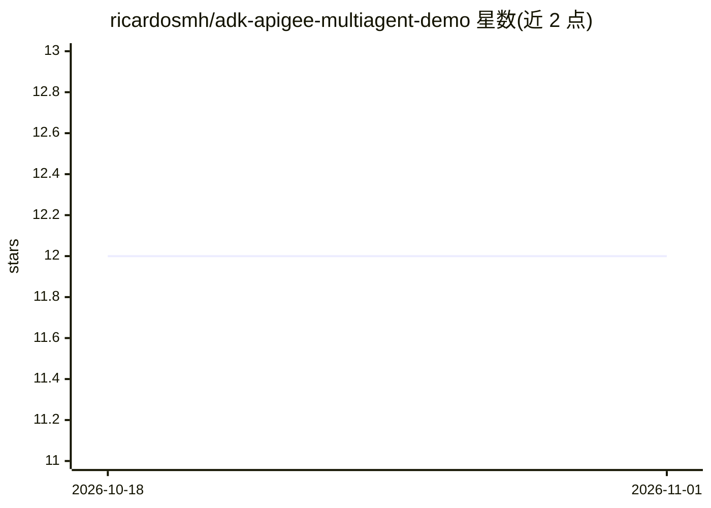

# ricardosmh/adk-apigee-multiagent-demo

⭐ 12 · Python · Apache-2.0 · 推送 2026-08-25 · [GitHub](https://github.com/ricardosmh/adk-apigee-multiagent-demo) · 个人维护

**Google Cloud 多智能体治理参考实现：Apigee 统一网关管控全部 LLM/A2A/MCP 调用**

在 Google Cloud 上构建企业治理型多智能体系统的参考实现：GEAP Agent Engine 上的 supervisor 智能体经 A2A 协议委托给三个领域专家智能体（订单/商品/客户），全部模型调用（Gemini 与 Claude）、MCP 工具调用与电商后端流量都经过 Apigee X 网关，实现按用户绑定的 API key、令牌配额与令牌分析。配套 IAP 身份、PSC 私有网络、单一 trace id 的四路日志与 Trace Explorer 回放。通过一个环境文件和三份清单驱动 check/apply 工具从三个空项目复现整套栈，面向构建企业级智能体基础设施的架构师与平台工程师；部署需数小时与三个 GCP 项目。

## 筛选速览

| 维度 | 判定 | 备注 |
|---|---|---|
| AI 角色 | `ai-ecosystem` | LLM/agent 周边工具 |
| 许可风险 | `permissive` | Apache-2.0 |
| 部署形态 | `None` |  |
| 模型依赖 | — | README 未给出锁定关系 |
| 硬件要求 | — | 无带数字的原话,不猜 |
| 安装摩擦 | `low` | 无编译、无系统依赖或容器化 |
| 成熟度 | — | 结构信号不足 |

## 能力要点

- supervisor + 3 领域专家智能体经 A2A 协议委托，逐轮自愈的注册表发现
- Apigee 网关统一管控模型/MCP/智能体/后端调用，按用户 API key 与令牌配额
- 单一 traceparent 贯穿 IAP、网关、引擎与微服务的端到端追踪与 Trace Explorer 回放
- 清单驱动的 --check/--dry-run/--apply 工具链从三个空项目复现全栈

## 适用场景

- 参考其模式构建带治理的企业多智能体架构
- 学习 Apigee 作为 LLM 网关（双厂商路由、令牌计量、按用户配额）的实现
- 搭建可复现的多项目 GCP 智能体演示环境并做审计

## 场景标签

`多智能体` `模型网关` · 领域:Agent 开发

## 证据(README 行号)

> L6: protocol**; **Apigee governs every data path** — model calls (Gemini *and*
> L87: The demo's central argument: **every** model call, tool call, agent invocation

## 星数曲线

2026-10-18 12 → 2026-11-01 12（+0）

---
*卡片 v1 · prompt 1.4 · 生成 2026-11-01 · 置信度 high · 依据 README sha `9c791a541e38` · [字段定义](../../DATASET.md)*
