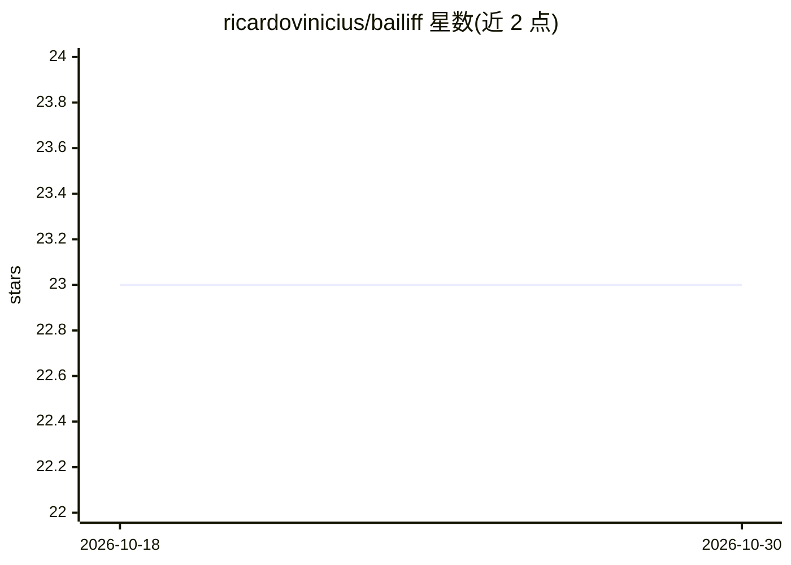

# ricardovinicius/bailiff

⭐ 23 · Python · 推送 2026-02-20 · [GitHub](https://github.com/ricardovinicius/bailiff) · 个人维护

**本地离线运行的 AI 会议助手：实时转写、说话人分离与会议问答**

隐私优先、完全本地运行的会议助手：通过 faster-whisper 做实时语音转写，用 SpeechBrain 嵌入加聚类识别说话人，将会议内容存入 ChromaDB 向量库构成本地 RAG，用户可基于本地 LLM（Ollama 或 OpenAI 兼容 API）与会议历史对话。采用多进程流水线架构（采集、扇出、转写、分离、合并、索引），以 Textual 构建 TUI 界面运行。音频捕获依赖 pyaudiowpatch，限 Windows 系统音频回环；需 Python 3.10+。

## 筛选速览

| 维度 | 判定 | 备注 |
|---|---|---|
| AI 角色 | `ai-native` | 本体是模型或模型工具 |
| 许可风险 | `none` | — |
| 部署形态 | `library` | 以包/库形式分发 |
| 模型依赖 | local-ok | 支持本地模型 |
| 硬件要求 | — | 无带数字的原话,不猜 |
| 安装摩擦 | `medium` | 含编译或系统依赖之一 |
| 成熟度 | — | 结构信号不足 |

## 能力要点

- faster-whisper 实时本地语音转写
- SpeechBrain 嵌入+聚类的说话人分离
- ChromaDB 向量库本地 RAG，可对话查询会议历史
- 支持 Ollama 或任意 OpenAI 兼容 API 作为助手后端

## 适用场景

- 在本地实时转写会议并区分不同发言人
- 会后通过对话检索和询问历史会议内容
- 对隐私敏感、音频不能上云的会议记录场景

## 场景标签

`语音识别` `RAG` · 领域:知识与检索

## 证据(README 行号)

> L19: - **Real-time Transcription**: Uses `faster-whisper` for high-performance, local speech-to-text.
> L22: - **AI Assistant**: Interact with your meeting data using local LLMs (via `Ollama` or compatible APIs).

## 星数曲线

2026-10-18 23 → 2026-10-30 23（+0）

---
*卡片 v1 · prompt 1.4 · 生成 2026-10-27 · 置信度 high · 依据 README sha `962dde755221` · [字段定义](../../DATASET.md)*
