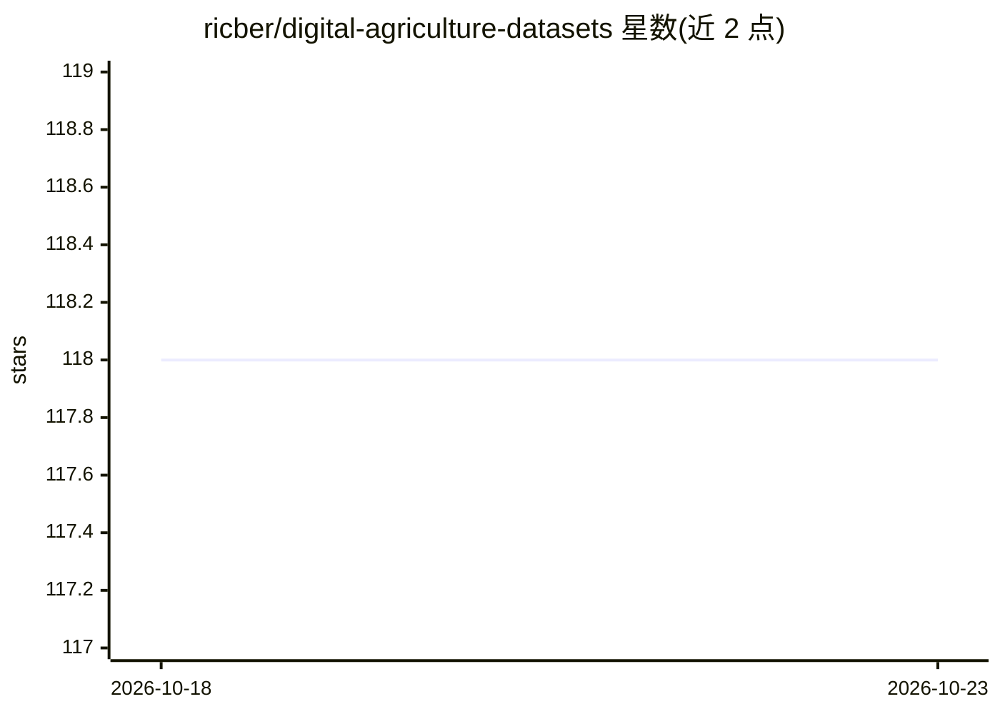

# ricber/digital-agriculture-datasets

⭐ 118 · GPL-3.0 · 推送 2026-07-31 · [GitHub](https://github.com/ricber/digital-agriculture-datasets) · 个人维护

**农业与野外机器人 AI 数据集策展清单**

策展公开数据集的清单仓库：面向农业与野外（off-road）环境的 AI 与机器人研发，按图像分类、语义分割、目标检测、实例分割、点云、跟踪、高光谱/多光谱、机器人导航等 11 个类别组织条目；传感模态覆盖 RGB、多光谱、高光谱与 3D LiDAR。条目多附 Data/Paper 链接，适用于精准农业、作物监测、杂草检测与野外自主导航等任务的模型训练与评测。不提供代码或安装方式，使用方式为按条目链接获取各数据集。

## 筛选速览

| 维度 | 判定 | 备注 |
|---|---|---|
| AI 角色 | `ai-knowledge` | 知识聚合/清单类 |
| 许可风险 | `viral` | GPL-3.0 |
| 部署形态 | `None` |  |
| 模型依赖 | — | README 未给出锁定关系 |
| 硬件要求 | — | 无带数字的原话,不猜 |
| 安装摩擦 | `medium` | 含编译或系统依赖之一 |
| 成熟度 | — | 结构信号不足 |

## 能力要点

- 按 11 个任务类别组织（分类/分割/检测/跟踪/机器人等）
- 覆盖 RGB、多光谱、高光谱、3D LiDAR 多种传感模态
- 多数条目附 Data 与 Paper 链接
- 收录大规模与无标注图像数据集、合成数据集工具等类别

## 适用场景

- 为杂草检测或作物病害识别模型寻找训练数据
- 为野外机器人导航与场景理解任务找数据集
- 对比不同任务下可用农业数据集的规模与标注类型

## 场景标签

`精选清单` · 领域:学习与行业

## 证据(README 行号)

> L1: # Digital Agriculture Datasets
> L2: This curated list gathers publicly available datasets supporting the development of artificial intelligence and robo

## 星数曲线

2026-10-18 118 → 2026-10-23 118（+0）

---
*卡片 v1 · prompt 1.4 · 生成 2026-10-23 · 置信度 high · 依据 README sha `0c1dee923102` · [字段定义](../../DATASET.md)*
