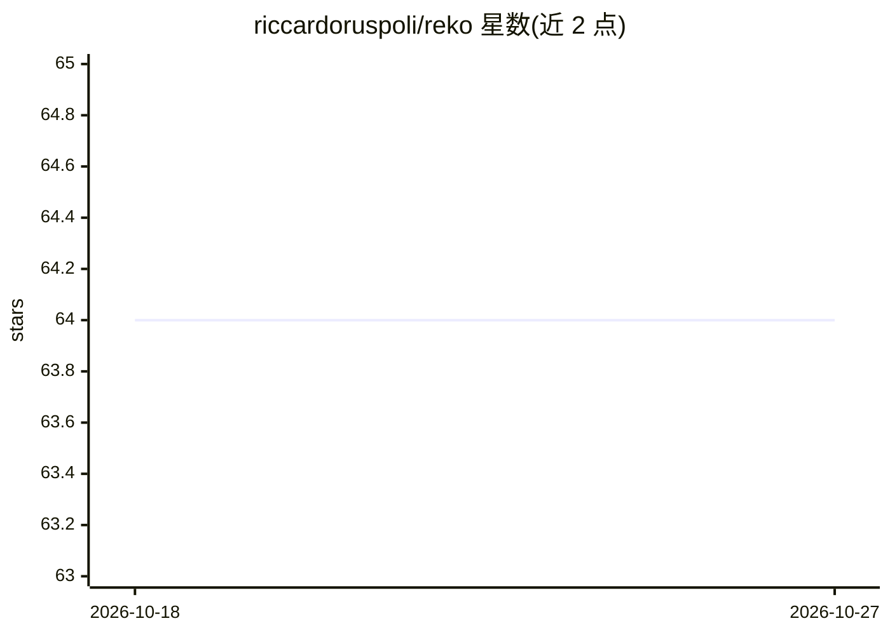

# riccardoruspoli/reko

⭐ 64 · Python · MIT · 推送 2026-10-01 · [GitHub](https://github.com/riccardoruspoli/reko) · 个人维护

**把 YouTube 视频转成 Markdown 摘要的本地优先 CLI 工具**

命令行工具：输入 YouTube 视频、播放列表或 URL 批量文件，抓取字幕并经 LLM 生成 Markdown 摘要、要点或 Brief。默认配合本地 Ollama 运行，也支持 openai 等云端 API。机制上按词分块逐段摘要后合并，OpenAI 官方模型可走基准化的全文单请求路由；字幕按视频 ID 与语言本地缓存，已有摘要时跳过重算。附带本地 Web UI（SSE 进度流、异步任务）与 Docker Compose 部署（容器不含 Ollama）。需 Python 3.10+ 与外部 LLM 端点。

## 筛选速览

| 维度 | 判定 | 备注 |
|---|---|---|
| AI 角色 | `ai-native` | 本体是模型或模型工具 |
| 许可风险 | `permissive` | MIT |
| 部署形态 | `self-host` | docker 或自建部署 |
| 模型依赖 | local-ok | 支持本地模型 |
| 硬件要求 | — | 无带数字的原话,不猜 |
| 安装摩擦 | `low` | 无编译、无系统依赖或容器化 |
| 成熟度 | — | 结构信号不足 |

## 能力要点

- 单个视频/播放列表/URL 批量文件转 Markdown 摘要、要点或 Brief
- 本地优先：默认 Ollama，也支持云端 API（LiteLLM 风格 openai/... 模型串）
- 按词分块摘要合并，OpenAI 官方模型有基准化全文路由
- 字幕按视频 ID+语言缓存，已有摘要跳过重处理
- 本地 Web UI 与 Docker Compose 部署

## 适用场景

- 把长视频转成可读的 Markdown 摘要或要点笔记
- 用本地 Ollama 模型离线批量总结播放列表
- 在家庭服务器上以 Web UI 方式总结视频链接

## 场景标签

`AI 写作` · 领域:内容生成

## 证据(README 行号)

> L13: `reko` is a command-line tool that converts YouTube videos into clean Markdown summaries using transcripts and Larg
> L18: By default, `reko` is local-first and privacy-friendly when used with Ollama, while still supporting paid cloud mod

## 星数曲线

2026-10-18 64 → 2026-10-27 64（+0）

---
*卡片 v1 · prompt 1.4 · 生成 2026-10-24 · 置信度 mid · 依据 README sha `1a09e5d7b93b` · [字段定义](../../DATASET.md)*
