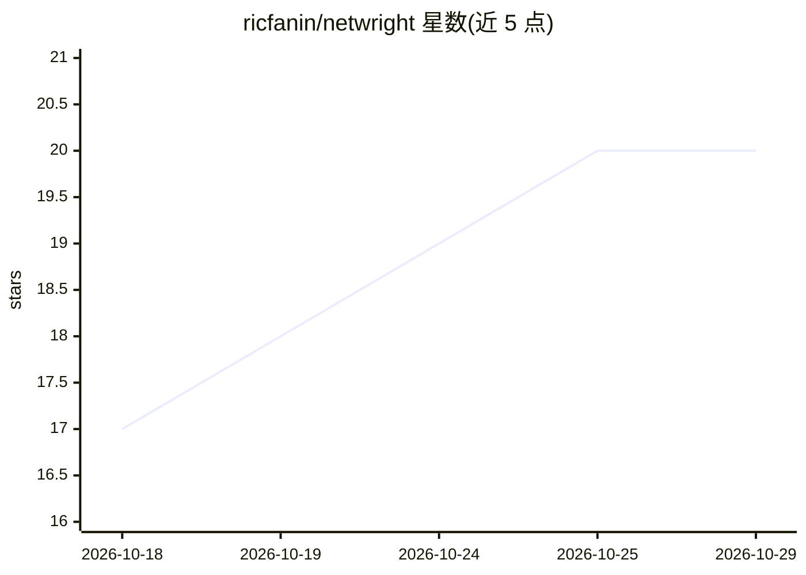

# ricfanin/netwright

⭐ 20 · C# · MIT · 推送 2026-10-26 · [GitHub](https://github.com/ricfanin/netwright) · [官网](https://www.nuget.org/packages/Netwright) · 个人维护

**MCP 服务器：让 AI agent 查看并操作 .NET 桌面应用**

面向 WPF、WinForms、WinUI/MAUI 等 .NET 桌面应用的 MCP 服务器，以 Playwright 风格提供 15 个 desktop_* 工具：启动项目、将 UI 读取为压缩文本快照、后台执行点击/输入等操作（不抢占前台鼠标）、重试式断言，并可把会话导出为基于 xUnit/NUnit/MSTest 的 C# 回归测试。动作返回 Change Report 以减少额外快照调用。要求 Windows 10/11 与 .NET 10 SDK，通过 dnx 或 dotnet 全局工具安装，可接入 Claude Code、Claude Desktop、Cursor、VS Code 等 MCP 客户端。

## 筛选速览

| 维度 | 判定 | 备注 |
|---|---|---|
| AI 角色 | `ai-ecosystem` | LLM/agent 周边工具 |
| 许可风险 | `permissive` | MIT |
| 部署形态 | `desktop` | 安装包/桌面程序 |
| 模型依赖 | — | README 未给出锁定关系 |
| 硬件要求 | — | 无带数字的原话,不猜 |
| 安装摩擦 | `medium` | 含编译或系统依赖之一 |
| 成熟度 | — | 结构信号不足 |

## 能力要点

- 15 个 desktop_* 工具覆盖快照、查找、点击、输入、截图、断言、日志
- 动作在后台执行，不抢占鼠标焦点，Refs 跨快照保持有效
- 会话可导出为 Netwright.Testing 上的 C# 回归测试（xUnit/NUnit/MSTest）
- 通过 UI Automation 支持 WPF/WinForms/WinUI/MAUI，Tier 1 技术有集成测试与基准

## 适用场景

- 让 AI agent 探索并操作我的 WPF/WinForms 应用完成端到端流程
- 把 agent 验证过的操作流程固化为可重复的回归测试
- 在持续开发中用 MCP 客户端自动化 .NET 桌面应用测试

## 场景标签

`GUI 自动化` · 领域:效率与自动化

## 证据(README 行号)

> L3: **Playwright-style automation for .NET desktop apps.** Netwright is an MCP server that lets AI agents see and operat
> L59: **Claude Code**
> L65: **Any MCP client** (Claude Desktop, Cursor, VS Code, Copilot…)

## 星数曲线

2026-10-18 17 → 2026-10-29 20（+3）

---
*卡片 v1 · prompt 1.4 · 生成 2026-10-28 · 置信度 high · 依据 README sha `6e9cb9f15d51` · [字段定义](../../DATASET.md)*
