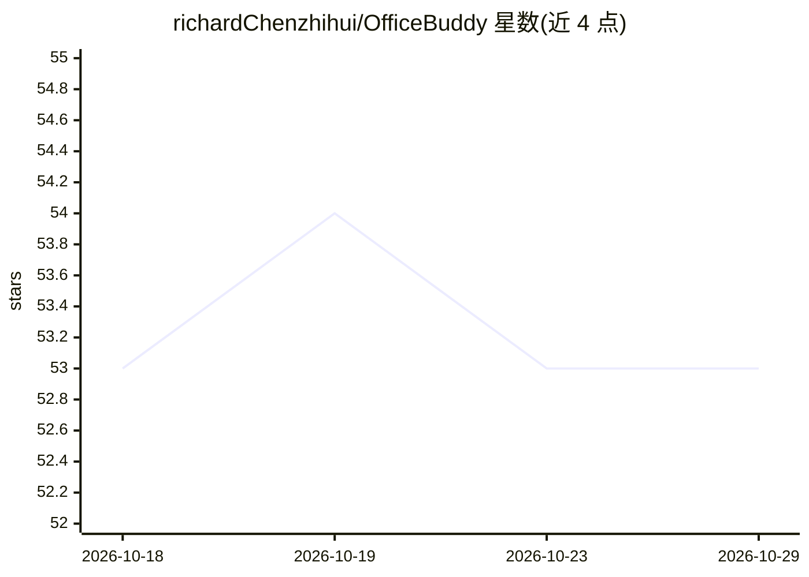

# richardChenzhihui/OfficeBuddy

⭐ 53 · Python · MIT · 推送 2026-08-07 · [GitHub](https://github.com/richardChenzhihui/OfficeBuddy) · 个人维护 · 中文 README

**macOS 上经真实 Word/Excel 渲染校验的文档编辑 Agent**

通过对话指令编辑 .docx/.xlsx 的 Python 命令行 Agent：每次编辑后由真实 Microsoft Word/Excel 渲染文档，像素 diff 定位变化区域，交由独立的无状态多模态验证器裁决，通过才推进基线，失败则按错误签名升级修复策略。提供快照/undo/restore、隔离副本与提示注入防御。要求 macOS、已安装 Word/Excel、Python 3.10+ 与 MiniMax API key；仅限 macOS，部分 Office 元素（图表/批注/修订）尚不支持往返。

## 筛选速览

| 维度 | 判定 | 备注 |
|---|---|---|
| AI 角色 | `ai-native` | 本体是模型或模型工具 |
| 许可风险 | `permissive` | MIT |
| 部署形态 | `library` | 以包/库形式分发 |
| 模型依赖 | — | README 未给出锁定关系 |
| 硬件要求 | — | 无带数字的原话,不猜 |
| 安装摩擦 | `low` | 无编译、无系统依赖或容器化 |
| 成熟度 | — | 结构信号不足 |

## 能力要点

- 每次编辑后由真实 Word/Excel 渲染并像素 diff 定位变化区域
- 独立无状态多模态验证器裁决后才推进基线
- 字节级快照索引支持任意时点 undo/restore
- Excel 保真守卫在保存前报告底层读取器会丢失的部分

## 适用场景

- 用自然语言指令修改 Word/Excel 文档并核验渲染结果
- 在交付前拦截结构合法但渲染可见损坏的文件
- 需要可回滚编辑历史的文档自动化流程

## 场景标签

`文档问答` · 领域:知识与检索

## 证据(README 行号)

> L10: Most document agents write bytes into a file and hope. OfficeBuddy renders the document
> L12: and hands the screenshot to a separate multimodal verifier that has to sign off before the
> L115: **Requirements:** macOS, Microsoft Word / Excel (they *are* the renderer), Python 3.10+, and a

## 星数曲线

2026-10-18 53 → 2026-10-29 53（+0）

---
*卡片 v1 · prompt 1.4 · 生成 2026-10-24 · 置信度 mid · 依据 README sha `5b73cf26465a` · [字段定义](../../DATASET.md)*
