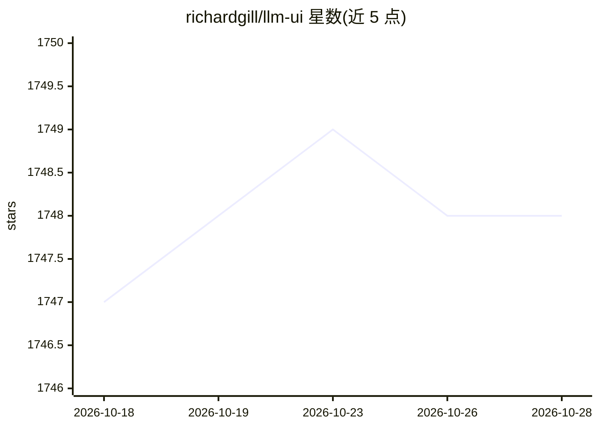

# richardgill/llm-ui

⭐ 1,748 · TypeScript · MIT · 推送 2026-09-29 · [GitHub](https://github.com/richardgill/llm-ui) · [官网](https://llm-ui.com) · 个人维护

**渲染 LLM 流式输出的 React 组件库**

面向开发者的 React 库，用于在 Web 前端展示大模型的流式输出：清理损坏的 markdown 语法、按原生帧率渲染、用节流平滑流式输出中的停顿、通过 Shiki 为各语言代码块着色，并允许向 LLM 输出注入自定义组件。采用 Headless 设计，不带样式，由使用者自带样式。以 MIT 许可开源。README 未展示具体安装命令。

## 筛选速览

| 维度 | 判定 | 备注 |
|---|---|---|
| AI 角色 | `ai-ecosystem` | LLM/agent 周边工具 |
| 许可风险 | `permissive` | MIT |
| 部署形态 | `None` |  |
| 模型依赖 | — | README 未给出锁定关系 |
| 硬件要求 | — | 无带数字的原话,不猜 |
| 安装摩擦 | `low` | 无编译、无系统依赖或容器化 |
| 成熟度 | — | 结构信号不足 |

## 能力要点

- 清理 LLM 输出中损坏的 markdown 语法
- 节流平滑流式停顿，按原生帧率渲染
- Shiki 支持各语言代码块高亮
- Headless 设计，可注入自定义组件

## 适用场景

- 为聊天类 LLM 应用构建输出渲染界面
- 在模型回答中嵌入自定义 React 组件
- 流式输出场景下获得平滑的渲染效果

## 场景标签

 · 领域:前端/LLM 应用开发

## 证据(README 行号)

> L3: The React library for LLMs.
> L10: - Add your own custom components to LLM output.

## 星数曲线

2026-10-18 1,747 → 2026-10-28 1,748（+1）

---
*卡片 v1 · prompt 1.4 · 生成 2026-10-21 · 置信度 high · 依据 README sha `6da7ec8077f5` · [字段定义](../../DATASET.md)*
