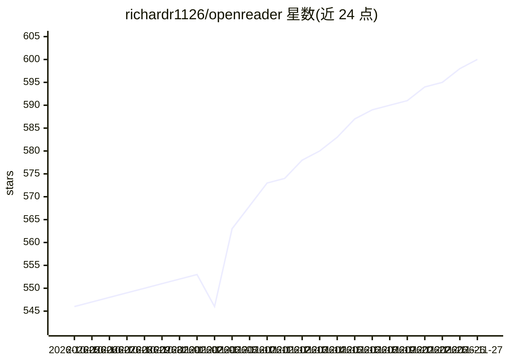

# richardr1126/openreader

⭐ 600 · TypeScript · MIT · 推送 2026-11-26 · [GitHub](https://github.com/richardr1126/openreader) · [官网](https://openreader.richardr.dev) · 个人维护

**自托管 TTS 文档阅读器：EPUB/PDF 等随读高亮并导出有声书**

基于 Next.js 的开源文本转语音文档阅读器，支持 EPUB、PDF、TXT、MD、DOCX 五种格式的同步跟读播放与 M4B/MP3 有声书导出。核心机制包括：PP-DocLayoutV3（ONNX）做版面感知 PDF 解析以实现跨页高亮同步；Kokoro 本地音素时长生成逐词高亮，其他提供商则用 ONNX Whisper 对齐；后端为 NATS JetStream 支撑的 compute worker，配合嵌入式 SeaweedFS/S3 存储与 SQLite/Postgres。提供 macOS/Windows/Linux 桌面安装包，也支持 Docker Compose、Vercel 部署与自托管服务，内置 MCP 服务器与版本化 REST API。

## 筛选速览

| 维度 | 判定 | 备注 |
|---|---|---|
| AI 角色 | `ai-native` | 本体是模型或模型工具 |
| 许可风险 | `permissive` | MIT |
| 部署形态 | `desktop` | 安装包/桌面程序 |
| 模型依赖 | — | README 未给出锁定关系 |
| 硬件要求 | — | 无带数字的原话,不猜 |
| 安装摩擦 | `low` | 无编译、无系统依赖或容器化 |
| 成熟度 | — | 结构信号不足 |

## 能力要点

- 五种可读格式（EPUB/PDF/TXT/MD/DOCX）同步跟读播放
- PP-DocLayoutV3 (ONNX) 版面感知解析与逐词高亮
- 多提供商 TTS：本地 Kokoro 无需 API key，另支持自托管 OpenAI 兼容服务器与多家云 API
- M4B/MP3 有声书导出，及内置 MCP 服务器与 REST API

## 适用场景

- 把 EPUB/PDF 文档转为可跟读的朗读页面并同步高亮
- 将电子书导出为 M4B/MP3 有声书
- 为团队自托管一个多格式文档朗读服务
- 录制或导入短样本用自己的声音叙述文档

## 场景标签

`语音合成` · 领域:内容生成

## 证据(README 行号)

> L13: OpenReader is an open-source, self-host-friendly text-to-speech document reader built with Next.js for **EPUB, PDF,
> L40: - 🎯 **Multi-provider TTS** — Kokoro running locally with no API key, self-hosted OpenAI-compatible servers (Kokoro-

## 星数曲线

2026-10-25 546 → 2026-11-27 600（+54）

---
*卡片 v1 · prompt 1.4 · 生成 2026-11-25 · 置信度 high · 依据 README sha `a5c0687edfc0` · [字段定义](../../DATASET.md)*
