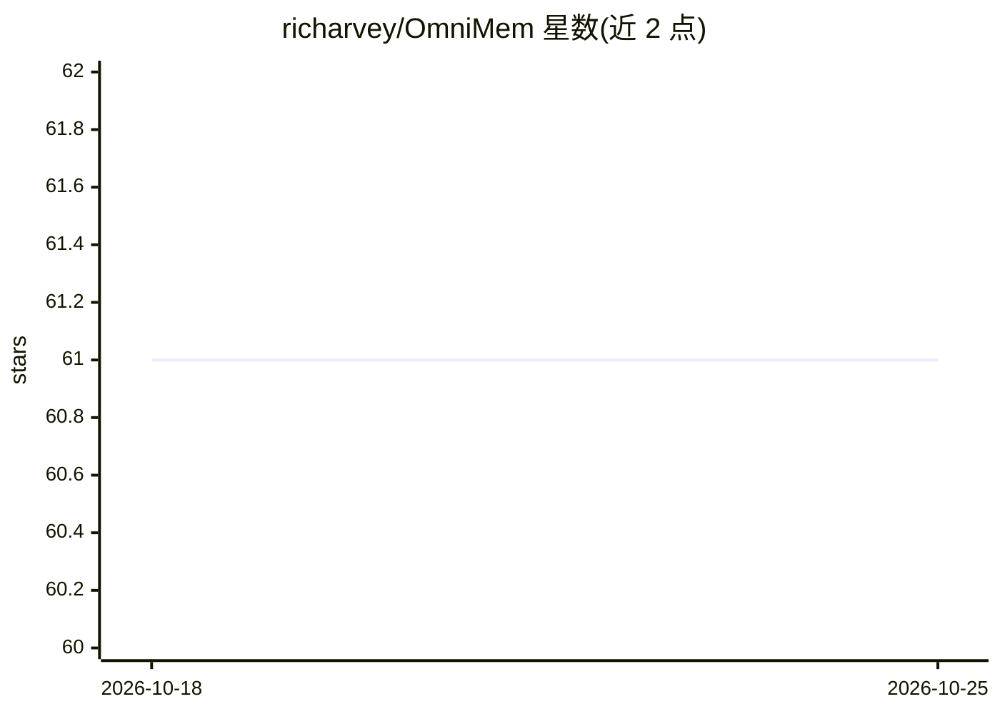

# richarvey/OmniMem

⭐ 61 · Rust · MIT · 推送 2026-10-24 · [GitHub](https://github.com/richarvey/OmniMem) · [官网](https://omnimem.org) · 个人维护

**给 AI agent 用的自托管跨会话语义记忆，经 MCP 提供服务**

单一 Rust 二进制程序，内含 MCP 服务器、记忆引擎、本地嵌入模型（all-MiniLM-L6-v2 on ONNX Runtime）、RSS 摄取与 SQLite 存储，可作桌面托盘应用或无头服务器运行。向任何 MCP agent（claude.ai、Claude Code、Cursor、Copilot、Codex CLI 等）提供 48 个工具，记忆分五类：情节记忆、项目上下文、知识、偏好与技能，配备死端记录（graveyard）、经验加权排序、矛盾检测、语义去重与生命周期管理，并可将经验编译为 SKILL.md 技能。可选接入 Anthropic API key 启用 Claude Haiku 的事实抽取等增强功能；不接则数据不出本机。MIT 许可，无托管版。

## 筛选速览

| 维度 | 判定 | 备注 |
|---|---|---|
| AI 角色 | `ai-ecosystem` | LLM/agent 周边工具 |
| 许可风险 | `permissive` | MIT |
| 部署形态 | `desktop` | 安装包/桌面程序 |
| 模型依赖 | — | README 未给出锁定关系 |
| 硬件要求 | — | 无带数字的原话,不猜 |
| 安装摩擦 | `low` | 无编译、无系统依赖或容器化 |
| 成熟度 | — | 结构信号不足 |

## 能力要点

- 单一二进制含 MCP 服务器、嵌入模型与 SQLite 存储，桌面/服务器两种运行形态
- 五类记忆（情节/项目/知识/偏好/技能）联合检索，排序含相似度×近因×经验权重
- graveyard 记录失败方案并在工具调用前拦截重复死端；Claude Code hooks 免主动调用
- 经验可编译为 SKILL.md 技能，propose-and-accept 门控

## 适用场景

- 让编码 agent 跨会话、跨项目、跨机器记住决策与踩过的坑
- 通过 RSS 订阅把读过的文章沉淀为 agent 可检索的知识
- 多台笔记本和多个 agent 通过反向代理共享同一份记忆

## 场景标签

`Agent 记忆` · 领域:Agent 开发

## 证据(README 行号)

> L13: OmniMem fixes that. It gives your AI agent a memory that lasts across sessions, projects and machines, over MCP, so
> L97: One memory for all of them: claude.ai, Claude Code, Claude Desktop, Cursor, GitHub Copilot, GitLab Duo, AWS Kiro, O

## 星数曲线

2026-10-18 61 → 2026-10-25 61（+0）

---
*卡片 v1 · prompt 1.4 · 生成 2026-10-24 · 置信度 high · 依据 README sha `e7e648263052` · [字段定义](../../DATASET.md)*
