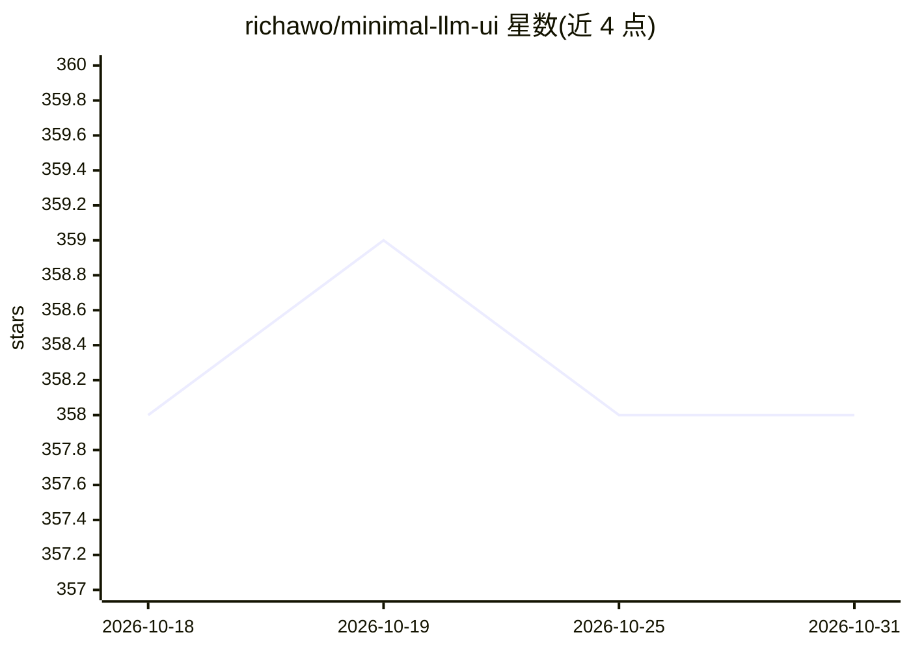

# richawo/minimal-llm-ui

⭐ 358 · TypeScript · MIT · 推送 2026-08-24 · [GitHub](https://github.com/richawo/minimal-llm-ui) · 个人维护

**本地 LLM 聊天界面：通过网页 UI 使用 Ollama 模型**

基于 React、Next.js 与 Tailwind CSS 构建的 Web 聊天界面，配合本地运行的 Ollama 使用（默认 http://localhost:11434）。功能包括与本地模型实时对话、对话中切换模型、内存中的上下文存储、对话历史保存到本地数据库、参数化提示词模板、自定义 Ollama API 地址。后端集成使用 LangchainJs 与 Ollama。安装方式为 npm install 后 npm run dev 从源码运行，要求 Node.js ≥14。

## 筛选速览

| 维度 | 判定 | 备注 |
|---|---|---|
| AI 角色 | `ai-ecosystem` | LLM/agent 周边工具 |
| 许可风险 | `permissive` | MIT |
| 部署形态 | `library` | 以包/库形式分发 |
| 模型依赖 | local-ok | 支持本地模型 |
| 硬件要求 | — | 无带数字的原话,不猜 |
| 安装摩擦 | `low` | 无编译、无系统依赖或容器化 |
| 成熟度 | — | 结构信号不足 |

## 能力要点

- 与本地 Ollama 模型实时对话，支持对话中途切换模型
- 对话历史保存至本地数据库
- 参数化提示词模板的创建与复用
- 支持配置远程 Ollama 主机的自定义 API 地址

## 适用场景

- 在本机浏览器中与本地模型对话
- 同一会话中切换不同模型做对比
- 保存和管理提示词模板与历史对话

## 场景标签

`聊天机器人` `提示工程` · 领域:Agent 开发

## 证据(README 行号)

> L1: Minimalistic Interface for Local Language Models (LLMs) (Powered by Ollama)
> L7: This minimalistic UI is designed to act as a simple interface for Ollama models, allowing you to chat with your mode
> L26: 1. Download and run Ollama on your machine with `ollama serve` or `ollama run <model-name>` (it will run at: http:/

## 星数曲线

2026-10-18 358 → 2026-10-31 358（+0）

---
*卡片 v1 · prompt 1.4 · 生成 2026-10-21 · 置信度 high · 依据 README sha `5d089f17fdcc` · [字段定义](../../DATASET.md)*
