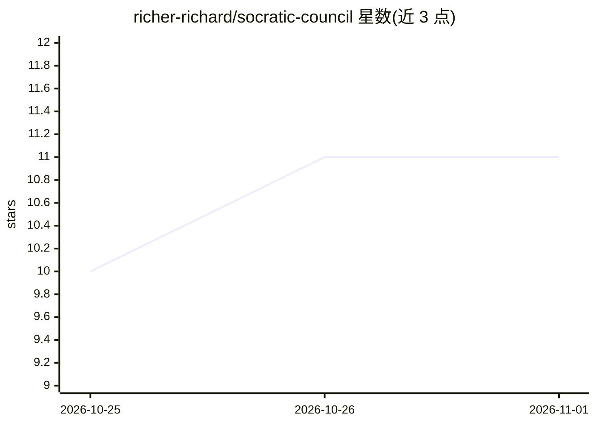

# richer-richard/socratic-council

⭐ 11 · Rust · Apache-2.0 · 推送 2026-10-25 · [GitHub](https://github.com/richer-richard/socratic-council) · 个人维护

**本地优先桌面应用：8 家 LLM 的 16 个 agent 辩论议题并产出决策记录**

基于 Tauri v2 的本地优先桌面应用，附带可独立安装的 Rust 终端 CLI/TUI。用户提供 8 家厂商（OpenAI/Anthropic/Gemini/DeepSeek/Kimi/Qwen/MiniMax/Z.AI）的 API key，输入议题后由主持人 agent 分派任务给各席位模型，经独立立场、交叉质询与工具调用（文件搜索、网页搜索、声明核验）达成收敛，输出含置信度、异议、证据与后续行动的决策记录。仓库仅提供源码，需从源码构建；另支持文档起草-批评-修订流程、成本追踪与 .scbundle 导出。

## 筛选速览

| 维度 | 判定 | 备注 |
|---|---|---|
| AI 角色 | `ai-native` | 本体是模型或模型工具 |
| 许可风险 | `permissive` | Apache-2.0 |
| 部署形态 | `desktop` | 安装包/桌面程序 |
| 模型依赖 | locked-api |  |
| 硬件要求 | — | 无带数字的原话,不猜 |
| 安装摩擦 | `medium` | 含编译或系统依赖之一 |
| 成熟度 | — | 结构信号不足 |

## 能力要点

- 主持人+多席位多轮辩论协议，直至席位收敛并生成决策记录
- 支持 8 家 LLM 提供商，默认 8 席可增删改配
- 研究工具链：附件、网页搜索、声明核验、沙盒 shell
- 同一 Rust 引擎驱动桌面端与终端 CLI/TUI（cargo install 可装）

## 适用场景

- 让多家前沿模型辩论复杂问题并产出带证据的决策记录
- 生成含批评与修订轮次的文档草稿
- 在无桌面环境的 VPS 上以终端方式运行同一工作流

## 场景标签

`多智能体` `AI 写作` · 领域:Agent 开发

## 证据(README 行号)

> L5: Socratic Council is a local-first desktop app that convenes a council of frontier models to settle a question. You b
> L20: |Providers|OpenAI, Anthropic, Google Gemini, DeepSeek, Kimi, Qwen, MiniMax, Z.AI|

## 星数曲线

2026-10-25 10 → 2026-11-01 11（+1）

---
*卡片 v1 · prompt 1.4 · 生成 2026-11-01 · 置信度 mid · 依据 README sha `41bfb9118fc7` · [字段定义](../../DATASET.md)*
