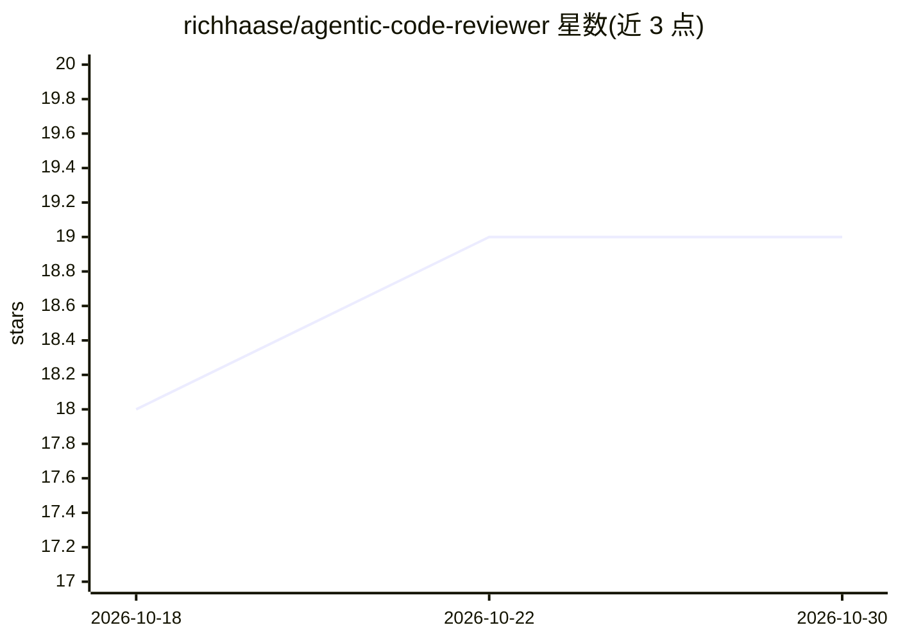

# richhaase/agentic-code-reviewer

⭐ 19 · Go · Apache-2.0 · 推送 2026-10-14 · [GitHub](https://github.com/richhaase/agentic-code-reviewer) · 个人维护

**并行运行多个 LLM agent CLI 做代码评审并聚合结果的 CLI 工具**

ACR 是 Go 编写的命令行工具：对 Git diff 生成多个并行评审者，各自调用 Antigravity、Codex、Claude Code（Gemini CLI 仅企业用户，消费级已弃用）等 LLM agent CLI，再用 LLM 汇总器聚类结果、按置信度过滤误报，输出合并报告并可发布到 GitHub PR。支持 watch 模式持续复审 PR、fork PR 评审、从不可变快照加载可信配置以避免被评审代码自定评审规则。需 Git 2.29+ 且至少安装认证一个 LLM CLI；watch 模式每周期约 8 次 agent 调用。

## 筛选速览

| 维度 | 判定 | 备注 |
|---|---|---|
| AI 角色 | `ai-native` | 本体是模型或模型工具 |
| 许可风险 | `permissive` | Apache-2.0 |
| 部署形态 | `library` | 以包/库形式分发 |
| 模型依赖 | — | README 未给出锁定关系 |
| 硬件要求 | — | 无带数字的原话,不猜 |
| 安装摩擦 | `low` | 无编译、无系统依赖或容器化 |
| 成熟度 | — | 结构信号不足 |

## 能力要点

- 多个 LLM agent CLI 并行评审后聚类汇总并过滤误报
- watch 模式跟踪 PR 变更、讨论与新提交自动复审直至 LGTM
- 可信配置从 canonical 远端默认分支不可变快照加载
- 支持 fork PR、临时 worktree 评审与 GitHub PR 发布

## 适用场景

- 提交前用多个 AI agent 并行审查代码改动
- 持续监督 PR，直到复审产出 LGTM
- 多评审者交叉覆盖不同类型的问题

## 场景标签

`代码审查` · 领域:编码与开发

## 证据(README 行号)

> L3: A CLI tool that runs parallel AI-powered code reviews using LLM agents (Antigravity CLI, Codex, Claude Code, or Gemi
> L64: ACR spawns multiple parallel reviewers, each invoking your chosen LLM agent (Antigravity, Codex, Claude, or enterpr

## 星数曲线

2026-10-18 18 → 2026-10-30 19（+1）

---
*卡片 v1 · prompt 1.4 · 生成 2026-10-28 · 置信度 high · 依据 README sha `4a67fc109828` · [字段定义](../../DATASET.md)*
