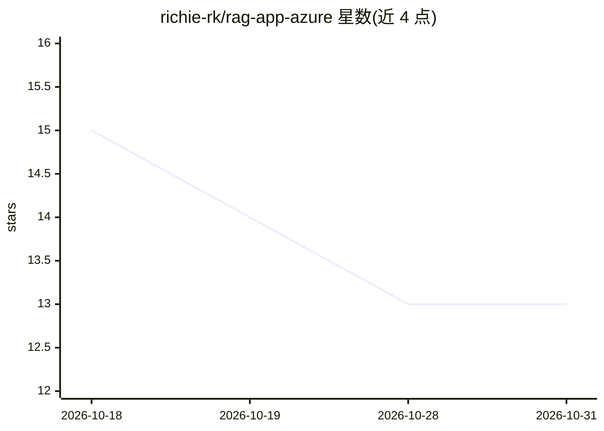

# richie-rk/rag-app-azure

⭐ 13 · Python · MIT · 推送 2026-09-01 · [GitHub](https://github.com/richie-rk/rag-app-azure) · 个人维护

**构建在 Azure 上的企业级 RAG 问答应用**

面向企业部署的检索增强问答应用：用户上传 PDF/DOCX/PPTX 等文档，经 Azure Durable Functions 管道摄取入库，通过 Azure AI Search 的向量+BM25+语义重排混合检索，由 Azure OpenAI 生成带引用的流式回答（NDJSON）。支持项目级多租户隔离（每项目独立索引、系统提示与访问列表）、Microsoft Entra ID SSO 与访客魔法链接登录。技术栈为 React+Fluent UI 9 前端与 FastAPI + Azure Functions 后端，用 Bicep 模板做基础设施即代码。README 声明仍在开发中、尚未达到生产可用。

## 筛选速览

| 维度 | 判定 | 备注 |
|---|---|---|
| AI 角色 | `ai-native` | 本体是模型或模型工具 |
| 许可风险 | `permissive` | MIT |
| 部署形态 | `library` | 以包/库形式分发 |
| 模型依赖 | locked-api |  |
| 硬件要求 | — | 无带数字的原话,不猜 |
| 安装摩擦 | `low` | 无编译、无系统依赖或容器化 |
| 成熟度 | `idea` | |

## 能力要点

- 向量+BM25+语义重排的单查询混合检索
- 项目级多租户隔离（独立索引/系统提示/访问列表）
- NDJSON 流式回答并附引用与追问建议
- Bicep + PowerShell 的 Azure 资源编排脚本

## 适用场景

- 在企业内为不同部门/团队部署隔离的文档问答系统
- 对私有文档做带引用溯源的自然语言问答
- 需要 SSO 与角色权限管理的企业知识库场景

## 场景标签

`文档问答` · 领域:知识与检索

## 证据(README 行号)

> L3: A Retrieval-Augmented Generation (RAG) app built on Azure. Upload documents and ask questions about them in natural 
> L16: The purpose of this project is to build an enterprise RAG application on Azure. It lets you upload documents and as
> L84: - **Hybrid retrieval** that combines vector search, BM25 keyword matching, and a semantic reranker in one Azure AI 

## 星数曲线

2026-10-18 15 → 2026-10-31 13（-2）

---
*卡片 v1 · prompt 1.4 · 生成 2026-10-31 · 置信度 mid · 依据 README sha `06e00f341a70` · [字段定义](../../DATASET.md)*
