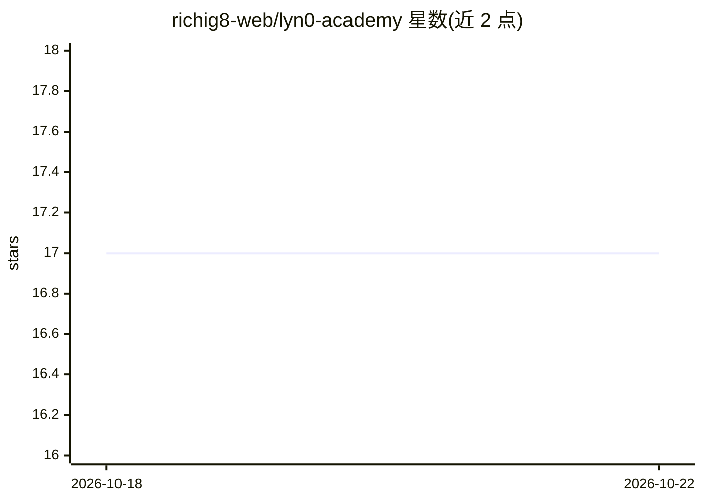

# richig8-web/lyn0-academy

⭐ 17 · Python · MIT · 推送 2026-10-18 · [GitHub](https://github.com/richig8-web/lyn0-academy) · 个人维护

**个人 AI agent 的分周任务包：教 agent 认识其主人**

面向 Hermes Agent 用户的任务包（mission pack）仓库：Mission 01 提供任务说明、由 agent 执行的访谈文档（10 个二选一 + 3 个开放问题）、SOUL/USER 两份模板，以及一个 Python 安装器。install.py 自动定位 Hermes home（Windows 为 %LOCALAPPDATA%\hermes，macOS/Linux 为 ~/.hermes），安装前自动备份，--check 检查空缺项。模板内容会被注入到每轮系统提示中，使 agent 持有身份与主人信息。要求本机已安装并运行 Hermes Agent，Python 3.9+，无其他依赖、无网络调用。MIT 许可。

## 筛选速览

| 维度 | 判定 | 备注 |
|---|---|---|
| AI 角色 | `ai-knowledge` | 知识聚合/清单类 |
| 许可风险 | `permissive` | MIT |
| 部署形态 | `None` |  |
| 模型依赖 | — | README 未给出锁定关系 |
| 硬件要求 | — | 无带数字的原话,不猜 |
| 安装摩擦 | `low` | 无编译、无系统依赖或容器化 |
| 成熟度 | `idea` | |

## 能力要点

- SOUL.md / USER.md 模板注入每轮系统提示
- install.py 自动定位 Hermes home 并做时间戳备份
- install.py --check 报告模板中仍空白或缺失的项
- 访谈由 agent 运行而非用户手工填写

## 适用场景

- 让本地 Hermes Agent 记住我的身份、工作与边界
- 每周完成一个任务逐步搭建个人 agent
- 检查 agent 在新会话中是否自行加载了主人信息

## 场景标签

`Agent 记忆` · 领域:Agent 开发

## 证据(README 行号)

> L9: This repository holds the mission packs. One folder per week. Install it, run it, and your
> L18: |`mission.md`|The mission itself: why it matters, the mechanism, the 5 steps|
> L22: |`install.py`|Finds your Hermes home, backs up what's there, installs the templates|

## 星数曲线

2026-10-18 17 → 2026-10-22 17（+0）

---
*卡片 v1 · prompt 1.4 · 生成 2026-10-18 · 置信度 mid · 依据 README sha `e6c73abf05db` · [字段定义](../../DATASET.md)*
