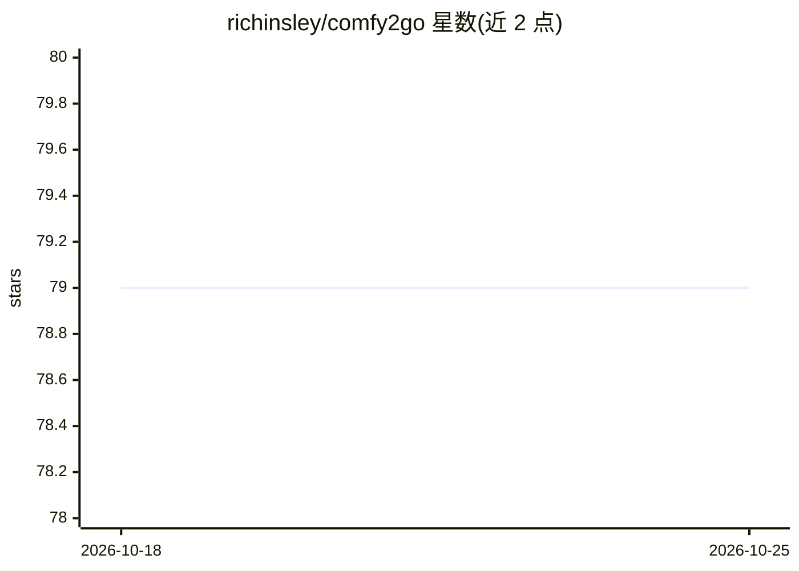

# richinsley/comfy2go

⭐ 79 · Go · MIT · 推送 2026-01-13 · [GitHub](https://github.com/richinsley/comfy2go) · 个人维护

**Go 库：桥接 ComfyUI 后端，提供工作流访问 API**

以 Go 库形式封装 ComfyUI 后端 API，分 GraphAPI 与 ClientAPI 两部分：GraphAPI 近似 ComfyUI 前端图式管线，支持查找与设置工作流各节点输入（不支持创建或编辑工作流）；ClientAPI 提供后端系统统计、多实例并发访问、图像与蒙版上传下载、创建与入队提示词、队列管理、提示词历史获取、从 PNG 加载工作流等能力。面向需要在自有 Go 应用中接入 ComfyUI 的开发者，通过 go get 安装后导入使用。限制：仅支持完整 ComfyUI 工作流，不支持 API Format 保存的工作流。

## 筛选速览

| 维度 | 判定 | 备注 |
|---|---|---|
| AI 角色 | `ai-ecosystem` | LLM/agent 周边工具 |
| 许可风险 | `permissive` | MIT |
| 部署形态 | `None` |  |
| 模型依赖 | — | README 未给出锁定关系 |
| 硬件要求 | — | 无带数字的原话,不猜 |
| 安装摩擦 | `low` | 无编译、无系统依赖或容器化 |
| 成熟度 | — | 结构信号不足 |

## 能力要点

- GraphAPI 支持查找与设置工作流各节点输入
- ClientAPI 支持多 ComfyUI 实例并发访问与队列管理
- 可从 PNG 文件加载工作流并入队执行
- 提供图像与蒙版上传下载、提示词历史获取

## 适用场景

- 在 Go 应用中接入并驱动 ComfyUI 执行文生图工作流
- 并发管理多个 ComfyUI 实例并查询后端系统统计
- 从 PNG 中恢复工作流并修改节点参数后提交执行

## 场景标签

`图像生成` · 领域:内容生成

## 证据(README 行号)

> L3: Comfy2go is a Go-based API that acts as a bridge to ComfyUI, a powerful and modular stable diffusion GUI and backend
> L9: Comfy2go allows for developers to harness ComfyUI's powerful features in a more accessible way. Comfy2go is comprise

## 星数曲线

2026-10-18 79 → 2026-10-25 79（+0）

---
*卡片 v1 · prompt 1.4 · 生成 2026-10-24 · 置信度 high · 依据 README sha `67cb2547e1a2` · [字段定义](../../DATASET.md)*
