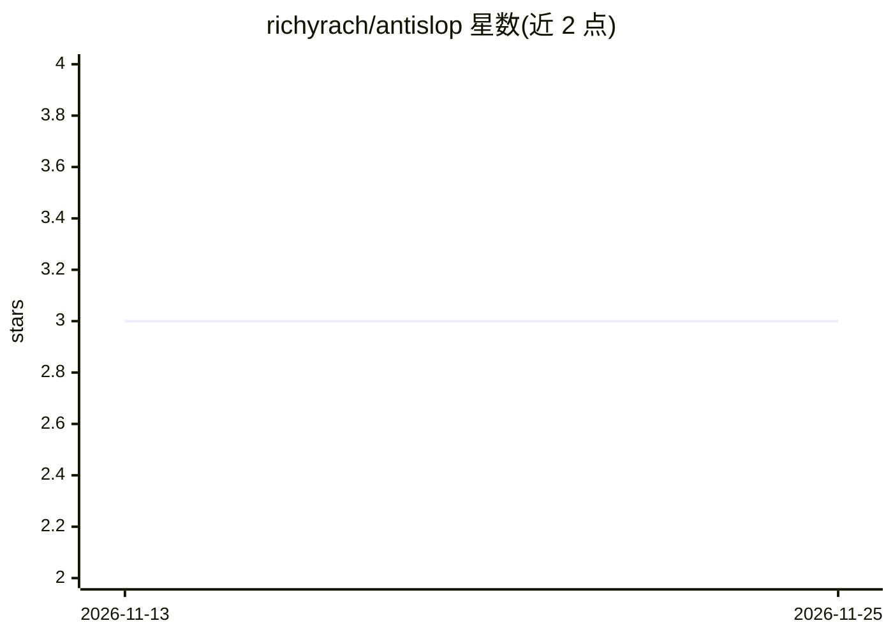

# richyrach/antislop

⭐ 3 · HTML · MIT · 推送 2026-11-12 · [GitHub](https://github.com/richyrach/antislop) · [官网](https://richyrach.github.io/antislop/) · 个人维护

**供 AI 在设计与生成 UI 前阅读的 Markdown 指南**

由六个 Markdown 文件组成的提示指南：AI 在设计或编写 UI 前先读取 GUIDE.md 及参考文件，指南给出取材、从主题提取配色与版式、不自造内容、通过可访问性底线等八步工作方法，并附视觉、排版、图片、文案、产品界面五份参考文档。作者用同一模型对照实验统计了 27 种 AI 页面特征计数，结果存于 evals/。无需安装依赖，可通过链接、复制粘贴或 npx skills 命令供任意 AI 工具使用；作者声明评测仅覆盖一个模型、十条请求，且计数脚本与指南同作者。

## 筛选速览

| 维度 | 判定 | 备注 |
|---|---|---|
| AI 角色 | `ai-knowledge` | 知识聚合/清单类 |
| 许可风险 | `permissive` | MIT |
| 部署形态 | `library` | 以包/库形式分发 |
| 模型依赖 | — | README 未给出锁定关系 |
| 硬件要求 | — | 无带数字的原话,不猜 |
| 安装摩擦 | `low` | 无编译、无系统依赖或容器化 |
| 成熟度 | — | 结构信号不足 |

## 能力要点

- 六个 Markdown 文件，无需安装，任何可读文件或打开链接的 AI 工具可用
- 可经 npx skills add 安装为 agent skill 并附带参考文件
- 指南含八步设计工作法与五份主题参考文档
- 附对照评测：统计 27 种 AI 页面特征的平均数对比

## 适用场景

- 用 AI 工具生成前端界面时先让它读这份指南
- 把 DESIGN.md 加入 CLAUDE.md 或 Cursor 规则约束 UI 风格
- 复现或扩展 evals/ 中的页面特征计数评测

## 场景标签

`提示工程` · 领域:Agent 开发

## 证据(README 行号)

> L3: A guide your AI reads before it designs or writes anything, so the result is not one everybody has already seen.
> L5: It is six Markdown files. There is nothing to install, and it works with any AI tool.
> L11: ## Use it

## 星数曲线

2026-11-13 3 → 2026-11-25 3（+0）

---
*卡片 v1 · prompt 1.4 · 生成 2026-11-21 · 置信度 high · 依据 README sha `fc5fef35faab` · [字段定义](../../DATASET.md)*
