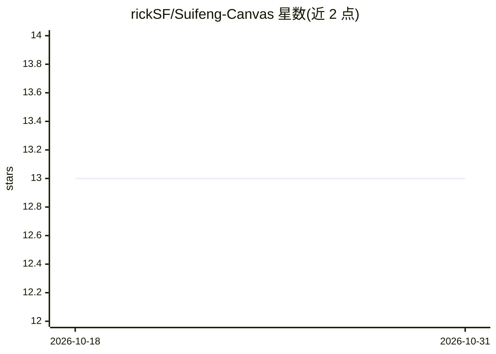

# rickSF/Suifeng-Canvas

⭐ 13 · TypeScript · 推送 2026-05-31 · [GitHub](https://github.com/rickSF/Suifeng-Canvas) · 个人维护 · 中文 README

**节点画布式 AI 分镜工作台：文生图、图生图与分镜生成一站式桌面工具**

面向 AI 内容创作者的桌面应用（Tauri 2 + React 18 + Rust + SQLite），以可视化节点画布串联文生图、图生图、图片编辑与分镜生成，支持 Seedream、Gemini、Nano Banana、GRSai 等图像生成模型，统一 API 层可扩展新模型。提供 SQLite 自动持久化、中英文 i18n、明暗主题。Windows 提供 .exe、macOS 提供 .dmg 安装包；Windows 启动需 WebView2 运行时。

## 筛选速览

| 维度 | 判定 | 备注 |
|---|---|---|
| AI 角色 | `ai-native` | 本体是模型或模型工具 |
| 许可风险 | `none` | — |
| 部署形态 | `desktop` | 安装包/桌面程序 |
| 模型依赖 | — | README 未给出锁定关系 |
| 硬件要求 | — | 无带数字的原话,不猜 |
| 安装摩擦 | `low` | 无编译、无系统依赖或容器化 |
| 成熟度 | — | 结构信号不足 |

## 能力要点

- 基于 @xyflow/react 的可视化节点画布编辑
- 接入 Seedream / Gemini / Nano Banana / GRSai 等图像生成模型
- 参考图自动拆分为故事板分镜，适合短剧/漫剧创作
- SQLite 自动持久化，图片经 imagePool 去重存储

## 适用场景

- 制作短剧或漫剧的分镜与概念设计
- 通过节点画布编排文生图、图生图与图片编辑流程
- 本地持久化管理 AI 创作项目数据

## 场景标签

`图像生成` · 领域:内容生成

## 证据(README 行号)

> L10: **随风画布**（Suifeng Canvas）是一款面向 AI 内容创作者的桌面工具，基于可视化节点画布，将文生图、图生图、图片编辑、分镜生成等 AI 能力串联成一条流畅的创作流水线。
> L25: - **多模型接入**：支持 Seedream、Gemini、Nano Banana、GRSai 等主流图像生成模型

## 星数曲线

2026-10-18 13 → 2026-10-31 13（+0）

---
*卡片 v1 · prompt 1.4 · 生成 2026-10-31 · 置信度 high · 依据 README sha `a1328dab7b65` · [字段定义](../../DATASET.md)*
