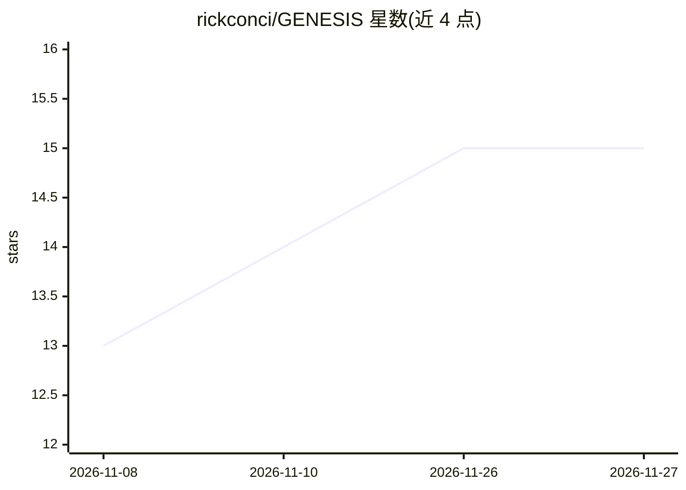

# rickconci/GENESIS

⭐ 15 · Python · MIT · 推送 2026-11-02 · [GitHub](https://github.com/rickconci/GENESIS) · 个人维护

**从实验协变量预测单细胞响应分布的生成式模型**

GENESIS（Generative ENErgy-based Single-cell Intervention Simulator）是单细胞扰动预测框架：仅凭定义实验条件的协变量，用轻量神经网络以 energy score 训练，生成整个细胞群体分布而非平均值；误差以同条件重复测量的可复现性为参照。仓库包含模型、训练与评分代码及论文全部图表的复现脚本，检查点与分数通过 Hugging Face 数据发布（门控访问）。推理与训练需要 CUDA GPU（模型部分仅限 Linux/Windows），CPU 仅可重绘图表。

## 筛选速览

| 维度 | 判定 | 备注 |
|---|---|---|
| AI 角色 | `ai-native` | 本体是模型或模型工具 |
| 许可风险 | `permissive` | MIT |
| 部署形态 | `None` |  |
| 模型依赖 | — | README 未给出锁定关系 |
| 硬件要求 | `cpu-ok` | |
| 安装摩擦 | `medium` | 含编译或系统依赖之一 |
| 成熟度 | — | 结构信号不足 |

## 能力要点

- 从协变量直接生成整个单细胞群体分布
- 以 energy score 训练，比较生成与实测细胞的分布
- 误差对照同条件重复实验的可复现性参照（Tahoe-100M、PBMC 细胞因子图谱）
- 四级复现链：图表→表格→分数→检查点均可从仓库重建

## 适用场景

- 预测未做过实验的单细胞扰动响应分布
- 复现论文全部图表与已发表数值
- 在 Tahoe-100M 或 PBMC 数据上训练/再评分自己的模型

## 场景标签

`科研工具` · 领域:学习与行业

## 证据(README 行号)

> L11: GENESIS (Generative ENErgy-based Single-cell Intervention Simulator) predicts the distribution of single-cell
> L18: - **Whole cell populations, not averages.** GENESIS generates single cells for a condition from its covariates alon

## 星数曲线

2026-11-08 13 → 2026-11-27 15（+2）

---
*卡片 v1 · prompt 1.4 · 生成 2026-11-18 · 置信度 high · 依据 README sha `b81aeb81f868` · [字段定义](../../DATASET.md)*
