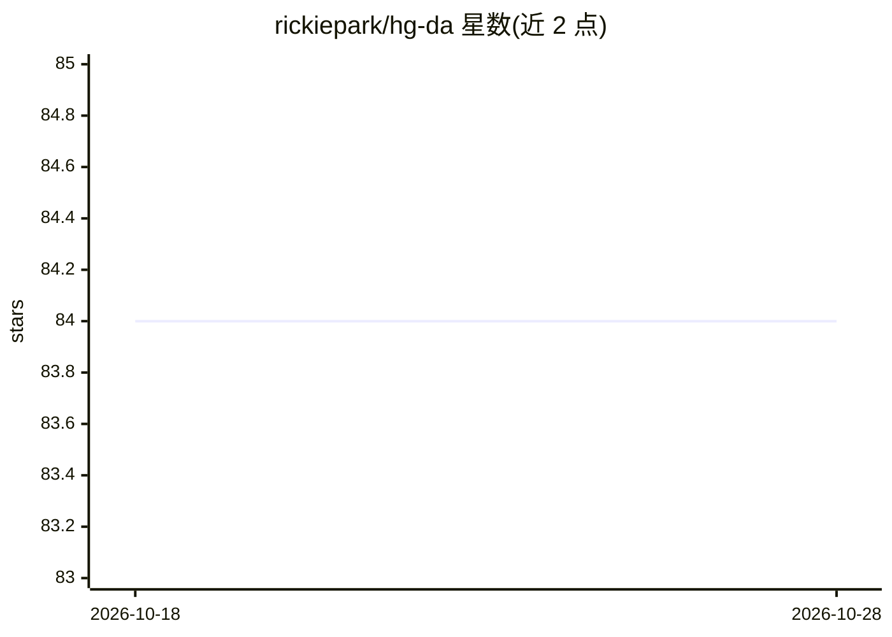

# rickiepark/hg-da

⭐ 84 · Jupyter Notebook · MIT · 推送 2025-11-25 · [GitHub](https://github.com/rickiepark/hg-da) · 个人维护

**韩文数据分析入门书的配套代码笔记本集**

《혼자 공부하는 데이터 분석 with 파이썬》（한빛미디어，2022）一书的代码存储库。每个小节对应一个独立的 Jupyter 笔记本（如 01-3.ipynb），全部笔记本可通过 Google Colab 点击链接运行。内容按章节组织，覆盖数据采集（API、网页抓取）、数据清洗、统计摘要与分布、matplotlib 可视化、统计推断与机器学习预测等。面向该书读者与 Python 数据分析自学者。

## 筛选速览

| 维度 | 判定 | 备注 |
|---|---|---|
| AI 角色 | `ai-knowledge` | 知识聚合/清单类 |
| 许可风险 | `permissive` | MIT |
| 部署形态 | `None` |  |
| 模型依赖 | — | README 未给出锁定关系 |
| 硬件要求 | — | 无带数字的原话,不猜 |
| 安装摩擦 | `low` | 无编译、无系统依赖或容器化 |
| 成熟度 | — | 结构信号不足 |

## 能力要点

- 每小节提供独立 Jupyter 笔记本
- 全部笔记本支持在 Google Colab 中运行
- 覆盖数据采集、清洗、可视化、统计推断与机器学习预测章节

## 适用场景

- 跟书逐步运行各章节示例代码
- 在 Colab 中免本地环境练习数据分析
- 查阅 API/网页抓取与 matplotlib 用法示例

## 场景标签

`教程课程` · 领域:学习与行业

## 证据(README 行号)

> L3: 이 저장소는 <혼자 공부하는 데이터 분석 with 파이썬>(한빛미디어, 2022)의 코드를 담고 있습니다.
> L5: 각 절의 코드는 독립된 하나의 노트북으로 제공됩니다. 예를 들어 1장 3절의 코드는 01-3.ipynb에 있습니다. 모든 노트북은 구글 코랩을 사용해 실행해 볼 수 있습니다. 노트북을 클릭하면 구글 코랩으로 

## 星数曲线

2026-10-18 84 → 2026-10-28 84（+0）

---
*卡片 v1 · prompt 1.4 · 生成 2026-10-24 · 置信度 high · 依据 README sha `71b450bdb6f4` · [字段定义](../../DATASET.md)*
