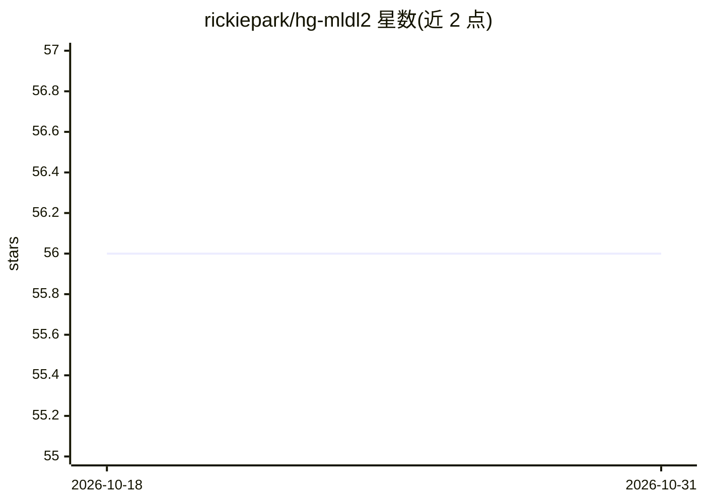

# rickiepark/hg-mldl2

⭐ 56 · Jupyter Notebook · MIT · 推送 2026-02-27 · [GitHub](https://github.com/rickiepark/hg-mldl2) · [官网](https://tensorflow.blog/hg-mldl2) · 个人维护

**韩文机器学习/深度学习入门书的配套示例代码库**

《혼자 공부하는 머신러닝+딥러닝(개정판)》(한빛미디어, 2025) 的官方代码仓库，收录书中按章节组织的 Jupyter Notebook。修订版新增 Transformer 与大语言模型章节，包含 KoBART、EXAONE、OpenAI API 的使用示例；深度学习部分原以 Keras 实现，修订版补充了 PyTorch 版本代码与讲解。每章每节提供 GitHub Notebook 与 Colab 运行链接两种打开方式，配套图书在 Yes24、教保文库、阿拉丁等线上线下书店销售。

## 筛选速览

| 维度 | 判定 | 备注 |
|---|---|---|
| AI 角色 | `ai-knowledge` | 知识聚合/清单类 |
| 许可风险 | `permissive` | MIT |
| 部署形态 | `None` |  |
| 模型依赖 | — | README 未给出锁定关系 |
| 硬件要求 | — | 无带数字的原话,不猜 |
| 安装摩擦 | `low` | 无编译、无系统依赖或容器化 |
| 成熟度 | — | 结构信号不足 |

## 能力要点

- 按章节组织书中全部示例 Notebook，附 Colab 链接
- 新增 Transformer 与大语言模型章节（KoBART/EXAONE/OpenAI API 示例）
- 深度学习示例同时提供 Keras 与 PyTorch 两版实现

## 适用场景

- 随书学习机器学习与深度学习并动手运行示例代码
- 在 Colab 中免配置运行书中 Notebook
- 对照学习 Keras 与 PyTorch 两种实现方式

## 场景标签

`教程课程` · 领域:学习与行业

## 证据(README 行号)

> L1: # <혼자 공부하는 머신러닝+딥러닝(개정판)>(한빛미디어, 2025)
> L3: 2020년에 출간된 베스트 셀러 인공지능 입문서인 <혼자 공부하는 머신러닝+딥러닝>의 최신 개정판입니다. 개정판에서는 트랜스포머와 대규모 언어 모델에 대한 장이 추가되었으며 KoBART, EXAONE, 오픈A

## 星数曲线

2026-10-18 56 → 2026-10-31 56（+0）

---
*卡片 v1 · prompt 1.4 · 生成 2026-10-24 · 置信度 high · 依据 README sha `966d9cb6eb0b` · [字段定义](../../DATASET.md)*
