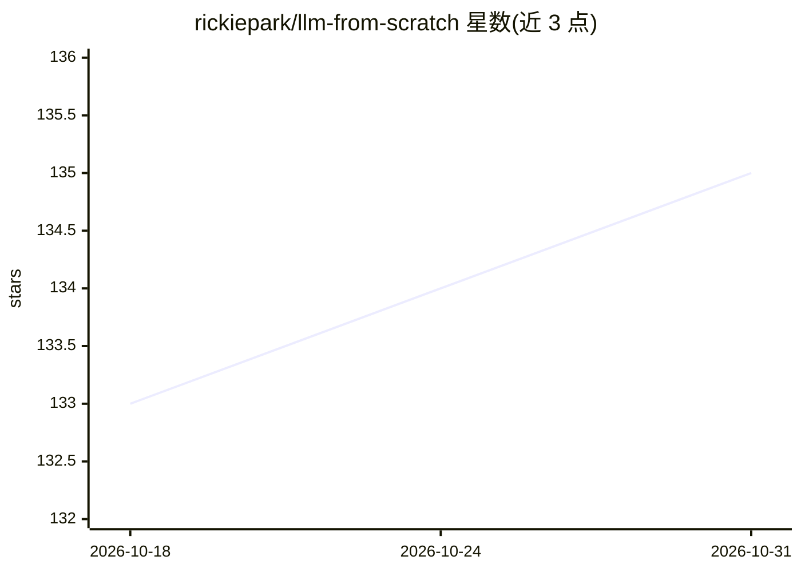

# rickiepark/llm-from-scratch

⭐ 135 · Jupyter Notebook · Apache-2.0 · 推送 2026-08-08 · [GitHub](https://github.com/rickiepark/llm-from-scratch) · [官网](https://tensorflow.blog/llm-from-scratch) · 个人维护

**韩文 LLM 教科书的官方代码仓库：从零实现 GPT 类模型**

《밑바닥부터 만들면서 배우는 LLM》(길벗, 2025) 一书的官方代码库，面向具备 Python 基础的学习者，用 PyTorch 从零构建、预训练并微调 GPT 类 LLM，不依赖外部 LLM 库。主要章节代码可在普通笔记本上运行，无需专用硬件，GPU 可用时自动利用。内容涵盖注意力机制、预训练、分类与指令微调，附 LoRA、DPO 及 Llama/Gemma/Qwen3 等模型从零实现的补充材料与各章练习题解答。

## 筛选速览

| 维度 | 判定 | 备注 |
|---|---|---|
| AI 角色 | `ai-knowledge` | 知识聚合/清单类 |
| 许可风险 | `permissive` | Apache-2.0 |
| 部署形态 | `None` |  |
| 模型依赖 | — | README 未给出锁定关系 |
| 硬件要求 | — | 无带数字的原话,不猜 |
| 安装摩擦 | `low` | 无编译、无系统依赖或容器化 |
| 成熟度 | — | 结构信号不足 |

## 能力要点

- 用 PyTorch 从零实现 GPT 类 LLM，不使用外部 LLM 库
- 涵盖预训练、分类微调、指令微调与 LoRA/DPO 等附加内容
- 主要代码可在普通笔记本运行，GPU 可用时自动利用
- 含各章练习题解答与 BPE tokenizer、KV Cache 等补充资料

## 适用场景

- 跟随书籍逐步编码理解 LLM 内部工作原理
- 学习从零构建并预训练、微调小型 GPT 模型
- 参考补充材料实现 Llama/Gemma/Qwen3 等架构

## 场景标签

`教程课程` · 领域:学习与行业

## 证据(README 行号)

> L3: <밑바닥부터 만들면서 배우는 LLM>(길벗, 2025) 책의 공식 코드 저장소로 GPT와 유사한 LLM의 개발, 사전 훈련, 미세 튜닝하기 위한 코드를 포함하고 있습니다.
> L61: 이 책은 외부 LLM 라이브러리를 사용하지 않고 파이토치(PyTorch)를 활용해 코드를 처음부터 구현합니다. 파이토치에 대한 숙련도는 필수는 아니지만, 파이토치의 기본 사항에 익숙하면 분명히 도움이 됩니다

## 星数曲线

2026-10-18 133 → 2026-10-31 135（+2）

---
*卡片 v1 · prompt 1.4 · 生成 2026-10-22 · 置信度 high · 依据 README sha `43c3fd2aa27c` · [字段定义](../../DATASET.md)*
