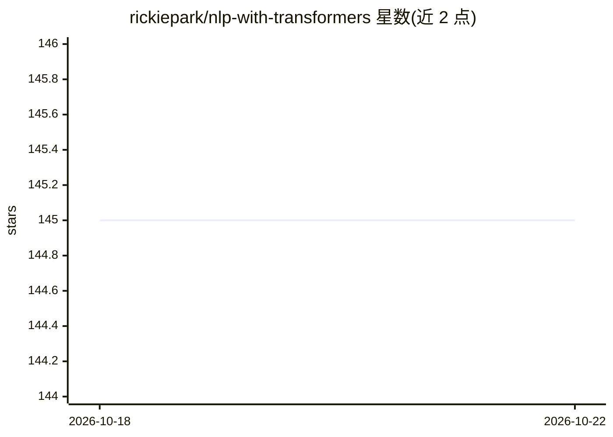

# rickiepark/nlp-with-transformers

⭐ 145 · Jupyter Notebook · Apache-2.0 · 推送 2026-03-08 · [GitHub](https://github.com/rickiepark/nlp-with-transformers) · [官网](https://bit.ly/transformer-home) · 个人维护

**《트랜스포머를 활용한 자연어 처리》一书配套示例代码库**

《Natural Language Processing with Transformers》韩文版（트랜스포머를 활용한 자연어 처리）的官方代码仓库，以 Jupyter Notebook 形式提供全书示例。每个笔记本附带 Google Colab 运行链接，并已在 Colab 上测试；本地运行需克隆仓库并创建 Python 虚拟环境或 Conda 环境。README 声明代码可能与最新版本库不兼容，笔记本首格输出记录了所用库版本，运行结果随库版本不同而变化。

## 筛选速览

| 维度 | 判定 | 备注 |
|---|---|---|
| AI 角色 | `ai-knowledge` | 知识聚合/清单类 |
| 许可风险 | `permissive` | Apache-2.0 |
| 部署形态 | `None` |  |
| 模型依赖 | — | README 未给出锁定关系 |
| 硬件要求 | — | 无带数字的原话,不猜 |
| 安装摩擦 | `low` | 无编译、无系统依赖或容器化 |
| 成熟度 | `idea` | |

## 能力要点

- 全书示例以 Jupyter Notebook 形式提供
- 每个笔记本含 Google Colab 可运行链接
- 笔记本首格记录所用库版本以便复现

## 适用场景

- 跟着《트랜스포머를 활용한 자연어 처리》一书动手练习 NLP/Transformers 示例
- 在 Colab 或本地环境中复现书中代码与输出
- 查阅特定库版本下的 Transformers 用法示例

## 场景标签

 · 领域:自然语言处理/教学

## 证据(README 行号)

> L3: 이 저장소는 트랜스포머를 활용한 자연어 처리 책의 코드 저장소입니다. 이 저장소의 코드는 최신 버전의 라이브러리와 호환되지 않을 수 있습니다. 각 노트북의 첫 번째 셀 출력에서 사용한 라이브러리 버전을 참고할
> L7: 이 책의 코드는 주피터 노트북으로 제공하며 구글 코랩에서 테스트했습니다. 주피터 노트북마다 구글 코랩에서 실행할 수 있는 링크가 포함되어 있습니다.

## 星数曲线

2026-10-18 145 → 2026-10-22 145（+0）

---
*卡片 v1 · prompt 1.4 · 生成 2026-10-22 · 置信度 high · 依据 README sha `86dfb55a5bfe` · [字段定义](../../DATASET.md)*
