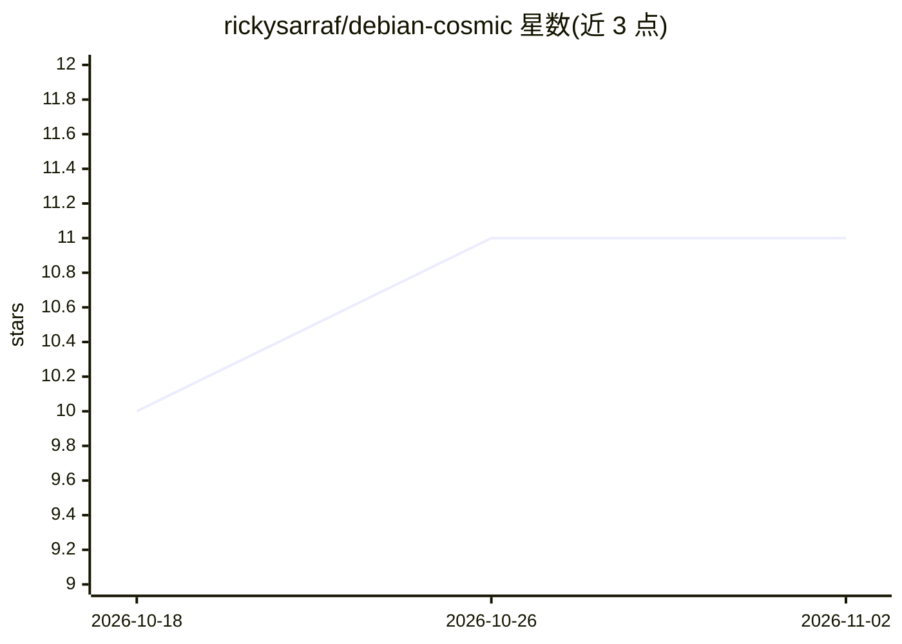

# rickysarraf/debian-cosmic

⭐ 11 · Python · 推送 2026-10-23 · [GitHub](https://github.com/rickysarraf/debian-cosmic) · 个人维护

**为 Debian Testing/Sid 打包 System76 COSMIC 桌面环境的项目**

社区维护的非官方打包工程，将 System76 COSMIC 桌面环境以两种形式交付到 Debian Testing/Unstable：统一 .deb 包（cosmic-epoch-monorepo 核心栈与 cosmic-utils-monorepo 小程序扩展）与 systemd-sysext 系统扩展（经 GHCR 分发的 OCI 镜像，面向进阶用户与不可变主机）。每周五 23:59 UTC 定时构建，提供签名 APT 仓库与直接下载 .deb 两种安装方式；本地构建需 Docker 与 justfile。README 声明与 Debian Project 及 System76 无隶属关系。

## 筛选速览

| 维度 | 判定 | 备注 |
|---|---|---|
| AI 角色 | `ai-enhanced` | 去掉 AI 部分产品仍成立 |
| 许可风险 | `none` | — |
| 部署形态 | `desktop` | 安装包/桌面程序 |
| 模型依赖 | — | README 未给出锁定关系 |
| 硬件要求 | — | 无带数字的原话,不猜 |
| 安装摩擦 | `low` | 无编译、无系统依赖或容器化 |
| 成熟度 | — | 结构信号不足 |

## 能力要点

- 提供 cosmic-epoch-monorepo 与 cosmic-utils-monorepo 两类 .deb 包
- systemd-sysext OCI 镜像交付，不改动主机 /usr
- 每周五定时构建并发布到 GitHub Releases
- 提供签名 APT 仓库实现自动更新

## 适用场景

- 在 Debian Testing/Sid 上安装和更新 COSMIC 桌面环境
- 在不可变主机或测试环境以 sysext 覆盖层运行 COSMIC
- 获取独立打包的 COSMIC 社区小程序扩展

## 场景标签

 · 领域:操作系统/桌面环境打包

## 证据(README 行号)

> L5: Welcome to the standalone **Debian COSMIC** project. This repository provides a unified delivery pipeline for the Sy
> L7: > **Note:** This is an unofficial, community-maintained convenience packaging effort. It is not affiliated with, end

## 星数曲线

2026-10-18 10 → 2026-11-02 11（+1）

---
*卡片 v1 · prompt 1.4 · 生成 2026-11-01 · 置信度 low · 依据 README sha `7994cdb60462` · [字段定义](../../DATASET.md)*
