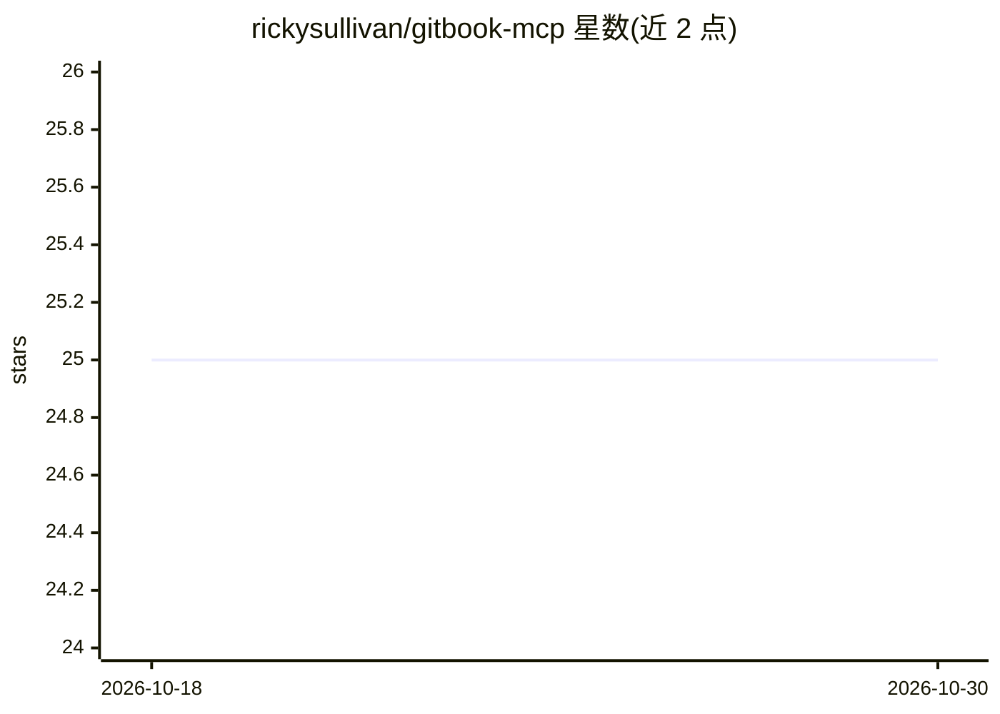

# rickysullivan/gitbook-mcp

⭐ 25 · JavaScript · MIT · 推送 2026-02-02 · [GitHub](https://github.com/rickysullivan/gitbook-mcp) · [官网](https://rickysullivan.gitbook.io/gitbook-mcp) · 个人维护

**接入 GitBook API 的 MCP 服务器，供 AI 助手读写文档**

面向 AI 助手与 LLM 应用的 Model Context Protocol 服务器，通过 12 个工具（组织/空间/集合发现、页面内容读取、全文检索、文件列表等）和 6 个文档工作流提示词（内容缺口分析、质量审计、摘要生成、内容优化）暴露 GitBook API。需 GitBook API token，配置途径含 CLI 参数、环境变量与 MCP 配置文件。提供 VS Code、Claude Desktop、JetBrains 等客户端接入示例；README 注明当前无单元/集成测试，npm run test 仅做类型检查。

## 筛选速览

| 维度 | 判定 | 备注 |
|---|---|---|
| AI 角色 | `ai-ecosystem` | LLM/agent 周边工具 |
| 许可风险 | `permissive` | MIT |
| 部署形态 | `library` | 以包/库形式分发 |
| 模型依赖 | — | README 未给出锁定关系 |
| 硬件要求 | — | 无带数字的原话,不猜 |
| 安装摩擦 | `low` | 无编译、无系统依赖或容器化 |
| 成熟度 | — | 结构信号不足 |

## 能力要点

- 12 个工具覆盖组织/空间/集合/页面/文件操作，多数为只读幂等
- 6 个文档工作流提示词：缺口分析、内容审计、摘要、SEO/可读性优化
- 支持 CLI 参数、环境变量、配置文件多种配置方式及默认参数行为

## 适用场景

- 让 Claude/Copilot 等 AI 助手直接检索和读取 GitBook 文档
- 在 IDE 中对文档做内容缺口分析与质量审计
- 用 AI 生成 GitBook 空间摘要与优化建议

## 场景标签

`提示工程` · 领域:Agent 开发

## 证据(README 行号)

> L3: A Model Context Protocol (MCP) server that provides access to GitBook's API for AI assistants and LLM applications.
> L7: The GitBook MCP server enables programmatic access to GitBook Organizations, Spaces, Collections, and Content throug

## 星数曲线

2026-10-18 25 → 2026-10-30 25（+0）

---
*卡片 v1 · prompt 1.4 · 生成 2026-10-26 · 置信度 high · 依据 README sha `7d153e10888f` · [字段定义](../../DATASET.md)*
