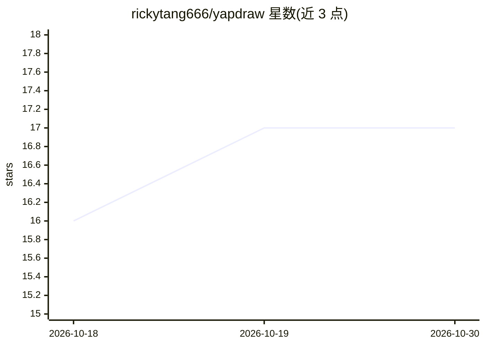

# rickytang666/yapdraw

⭐ 17 · TypeScript · MIT · 推送 2026-03-24 · [GitHub](https://github.com/rickytang666/yapdraw) · [官网](https://yapdraw.vercel.app) · 个人维护

**语音描述生成 Excalidraw 图表的网页应用**

面向需要快速画图的用户：对着麦克风口述系统架构、流程或项目计划，应用将其转为可编辑的 Excalidraw 图表。支持句中修正与增量更新（仅改动提及部分而非重建全图）、本地浏览器存储（无账号、数据不出本机）、AI 变更历史快照与撤销。语音转文字用 Deepgram，布局引擎用 Dagre，前端为 Next.js。免费额度开箱即用，也可在设置中填入 OpenRouter 或 Gemini key 获取更高限额。

## 筛选速览

| 维度 | 判定 | 备注 |
|---|---|---|
| AI 角色 | `ai-native` | 本体是模型或模型工具 |
| 许可风险 | `permissive` | MIT |
| 部署形态 | `library` | 以包/库形式分发 |
| 模型依赖 | — | README 未给出锁定关系 |
| 硬件要求 | — | 无带数字的原话,不猜 |
| 安装摩擦 | `low` | 无编译、无系统依赖或容器化 |
| 成熟度 | — | 结构信号不足 |

## 能力要点

- 口述内容直接生成可编辑的 Excalidraw 图表
- 增量更新：仅改动指令涉及的部分，保留手动编辑
- 本地优先：图表数据存于浏览器 IndexedDB，无需账号
- AI 变更历史快照，可用 [ / ] 键逐步回溯

## 适用场景

- 口述系统架构或业务流程快速产出图表
- 对话式迭代修改现有图表（增删节点、改连线）
- 在空白白板前不知从何画起时用语音起稿

## 场景标签

 · 领域:生产力工具/图表

## 证据(README 行号)

> L13: YapDraw is Wispr Flow for Excalidraw.
> L15: Describe anything out loud — a system architecture, a business process, a research workflow, a project plan — and i

## 星数曲线

2026-10-18 16 → 2026-10-30 17（+1）

---
*卡片 v1 · prompt 1.4 · 生成 2026-10-29 · 置信度 high · 依据 README sha `33ef149de9f9` · [字段定义](../../DATASET.md)*
