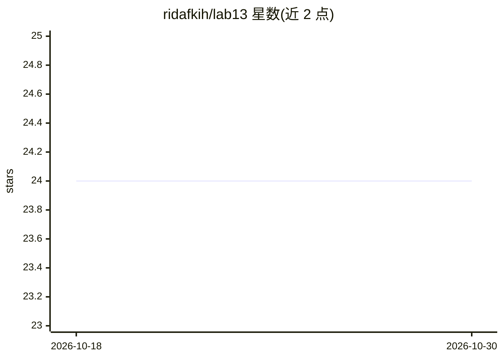

# ridafkih/lab13

⭐ 24 · TypeScript · AGPL-3.0 · 推送 2026-02-19 · [GitHub](https://github.com/ridafkih/lab13) · 个人维护

**多会话开源后台代理平台：经聊天指令在容器中启动代码代理**

受 Ramp Inspect 启发的实验性后台代理系统，由 Bun、Docker、OpenCode 与 Vercel agent-browser 驱动。用户为项目预配置开发 Docker 镜像，通过聊天平台（iMessage 或 Web UI）向 Orchestrator 下达指令，系统为每个会话生成容器集群并启动代理执行任务；代理可访问浏览器、查看日志、截屏、评估样式并在变更时通知用户，会话可并行观察。README 标注为实验性且内容为占位，详细文档待补。

## 筛选速览

| 维度 | 判定 | 备注 |
|---|---|---|
| AI 角色 | `ai-ecosystem` | LLM/agent 周边工具 |
| 许可风险 | `viral` | AGPL-3.0 |
| 部署形态 | `None` |  |
| 模型依赖 | — | README 未给出锁定关系 |
| 硬件要求 | — | 无带数字的原话,不猜 |
| 安装摩擦 | `low` | 无编译、无系统依赖或容器化 |
| 成熟度 | `idea` | |

## 能力要点

- 按会话生成预配置 Docker 容器集群
- 通过 iMessage 或 Web UI 向 Orchestrator 下达指令
- 代理可访问浏览器、查看日志、截屏、评估样式
- 多会话并行观察与预览变更

## 适用场景

- 通过聊天工具远程让代理在隔离容器里完成开发任务
- 并行管理多个代理会话并实时查看日志与变更
- 为不同项目配置独立容器环境供代理运行

## 场景标签

`编码 Agent` · 领域:编码与开发

## 证据(README 行号)

> L9: Create projects with pre-defined container configurations, and spin up agents whether through manual provisioning or
> L16:  1. Provide one or more development Docker images, this cluster will be spawned for each new session.

## 星数曲线

2026-10-18 24 → 2026-10-30 24（+0）

---
*卡片 v1 · prompt 1.4 · 生成 2026-10-27 · 置信度 mid · 依据 README sha `4a0f340dfac0` · [字段定义](../../DATASET.md)*
