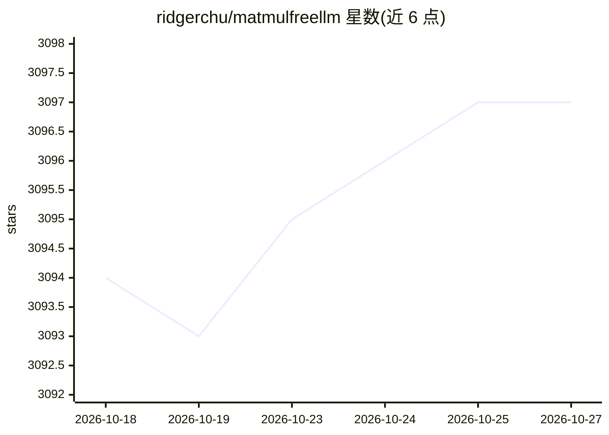

# ridgerchu/matmulfreellm

⭐ 3,097 · Python · Apache-2.0 · 推送 2026-09-06 · [GitHub](https://github.com/ridgerchu/matmulfreellm) · 个人维护

**给研究者的免矩阵乘语言模型实现库：基于 HuggingFace 兼容接口**

MatMul-Free LM 论文（Nature Computational Science）的官方实现，从 flash-linear-attention 仓库改编而来。提供消除矩阵乘法运算的语言模型架构代码，以 🤗 Transformers 兼容库形式发布，可通过 AutoModel 初始化、用 text generation API 生成文本。提供 370M/1.3B/2.7B 预训练模型信息（训练 15B-100B tokens），比较了与 Transformer++ 的 scaling law 表现。依赖 PyTorch>=2.0、Triton>=2.2，Apache 2.0 许可。

## 筛选速览

| 维度 | 判定 | 备注 |
|---|---|---|
| AI 角色 | `ai-native` | 本体是模型或模型工具 |
| 许可风险 | `permissive` | Apache-2.0 |
| 部署形态 | `library` | 以包/库形式分发 |
| 模型依赖 | — | README 未给出锁定关系 |
| 硬件要求 | — | 无带数字的原话,不猜 |
| 安装摩擦 | `low` | 无编译、无系统依赖或容器化 |
| 成熟度 | — | 结构信号不足 |

## 能力要点

- 免矩阵乘的语言模型架构实现，兼容 🤗 Transformers（AutoModel 初始化）
- 提供 370M/1.3B/2.7B 预训练模型规模信息
- v0.1.0 为论文关联的存档软件发布
- 支持通过 text generation API 生成文本

## 适用场景

- 运行或微调免矩阵乘语言模型进行文本生成
- 复现论文中 370M-2.7B 模型的 scaling law 实验
- 在 HuggingFace 生态中集成该架构

## 场景标签

`微调` `模型训练` · 领域:训练与推理

## 证据(README 行号)

> L8: MatMul-Free LM is a language model architecture that eliminates the need for Matrix Multiplication (MatMul) operatio
> L48: Upon successfully pretraining a model, it becomes accessible for generating text using the 🤗 text generation APIs.
> L60: Version `v0.1.0` is the archival software release associated with the Nature Computational Science manuscript. Its 

## 星数曲线

2026-10-18 3,094 → 2026-10-27 3,097（+3）

---
*卡片 v1 · prompt 1.4 · 生成 2026-10-20 · 置信度 high · 依据 README sha `e7c68d09372b` · [字段定义](../../DATASET.md)*
