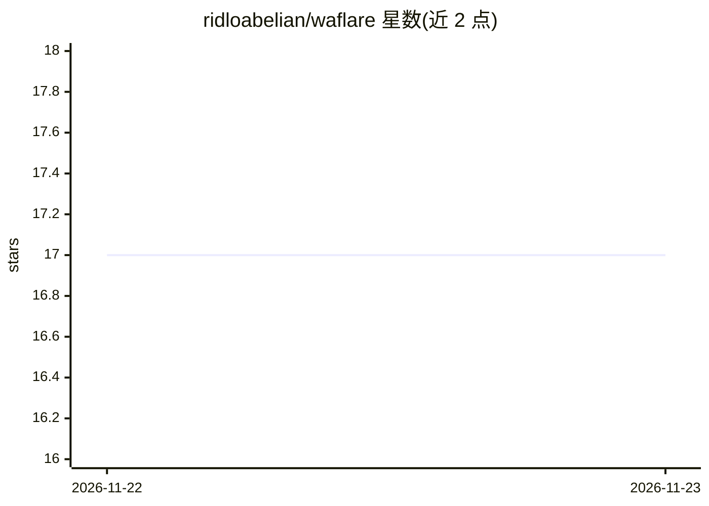

# ridloabelian/waflare

⭐ 17 · TypeScript · MIT · 推送 2026-11-21 · [GitHub](https://github.com/ridloabelian/waflare) · [官网](https://ridlo.id/waflare) · 个人维护

**WhatsApp 业务运营的 Cloudflare Workers 一体化平台**

将 27 个开源仓库的模式合并为单个零依赖的 Cloudflare Worker：WhatsApp 云 API webhook 网关（HMAC 验证、多路复用、防封限流）、自托管 CRM 与 24 小时回复窗口收件箱、多渠道分发、28 工具的双模式 MCP 服务器、多 LLM 故障切换的 AI Agent、`/sql` 与 `/rag` 检索、Whisper 语音转录与 ElevenLabs TTS、审批制 Cloudflare 运维操作，以及 Plexi E2EE 密钥透明审计。可部署到 Cloudflare Workers，也可在本地 Node.js 22+ 直接运行，并提供带 6 个标签页的 Web 管理台。

## 筛选速览

| 维度 | 判定 | 备注 |
|---|---|---|
| AI 角色 | `ai-native` | 本体是模型或模型工具 |
| 许可风险 | `permissive` | MIT |
| 部署形态 | `library` | 以包/库形式分发 |
| 模型依赖 | — | README 未给出锁定关系 |
| 硬件要求 | — | 无带数字的原话,不猜 |
| 安装摩擦 | `low` | 无编译、无系统依赖或容器化 |
| 成熟度 | — | 结构信号不足 |

## 能力要点

- 单 Worker 内含 8 大架构支柱，覆盖网关/CRM/MCP/AI 语音/ChatOps/密钥审计
- 28 工具 MCP 服务器支持 Claude Desktop/Cursor/Claude Code 客户端接入与只读锁
- 多 LLM 故障切换链：Workers AI → OpenAI → OpenRouter → Groq → Edge，按用量记账
- 审批门控的 Cloudflare 运维操作（缓存清除、DNS、KV 写入）

## 适用场景

- 在 WhatsApp 上搭建带 CRM 收件箱的客户服务与营销机器人
- 把 WhatsApp 消息作为 MCP 工具接入 Claude Desktop 或 Cursor
- 通过聊天按钮审批执行 Cloudflare 运维操作
- 对语音留言自动转录、摘要并以 TTS 回复

## 场景标签

`聊天机器人` `RAG` `语音识别` `语音合成` · 领域:对话与助手

## 证据(README 行号)

> L13: Instead of gluing together separate bots for WhatsApp webhooks, MCP servers, CRM inboxes, Whisper voice transcripti
> L31: |**4. Autonomous AI, `/sql` vs `/rag` & Vertical Skills**|`src/agents/orchestrator.ts`, `src/agents/memory.ts`, `sr

## 星数曲线

2026-11-22 17 → 2026-11-23 17（+0）

---
*卡片 v1 · prompt 1.4 · 生成 2026-11-22 · 置信度 high · 依据 README sha `9784b195f056` · [字段定义](../../DATASET.md)*
