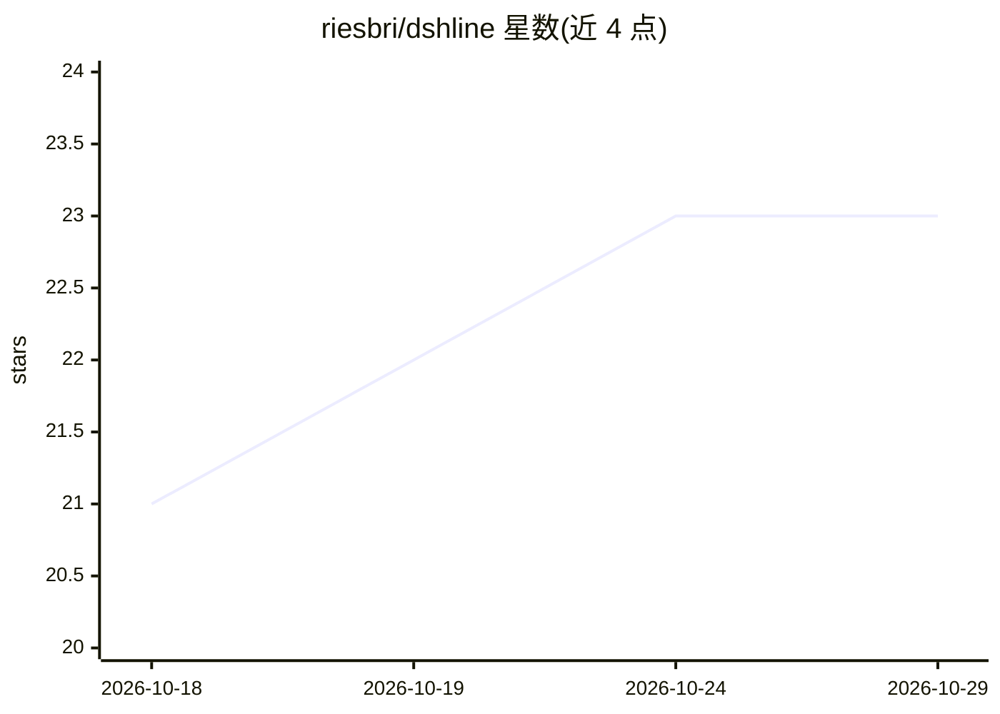

# riesbri/dshline

⭐ 23 · TypeScript · MIT · 推送 2026-10-28 · [GitHub](https://github.com/riesbri/dshline) · [官网](https://dshline.xyz) · 个人维护 · 中文 README

**DeepSeek Harness 的终端原生 TUI 前端，带真实滚动回显**

以进程内插件形式运行的 DeepSeek Harness 终端前端：不创建并行 agent 运行时或状态层，而是通过标准 Harness 能力接口（ctx.jobs、ctx.subagents、ctx.sessionQuery 等）消费 Harness 的模型、会话、凭据与策略，仅负责终端呈现。完成的输出写入终端自身滚动区，仅重绘有限的活动区域；不内置 provider 列表与登录协议，模型经 Harness 配置。需 npm 全局安装且依赖 pnpm，同一时间仅支持一个 Harness 生成版；沙箱与工具权限由活动 Harness profile 控制，普通工具调用可能无逐次审查。

## 筛选速览

| 维度 | 判定 | 备注 |
|---|---|---|
| AI 角色 | `ai-ecosystem` | LLM/agent 周边工具 |
| 许可风险 | `permissive` | MIT |
| 部署形态 | `library` | 以包/库形式分发 |
| 模型依赖 | locked-api |  |
| 硬件要求 | — | 无带数字的原话,不猜 |
| 安装摩擦 | `low` | 无编译、无系统依赖或容器化 |
| 成熟度 | — | 结构信号不足 |

## 能力要点

- 以标准能力接口消费 Harness，无需 provider 专属代码
- 完成输出提交到真实终端滚动区，不重写、可选择可复制
- 不内置 provider 列表与登录协议，经 /connect 由 Harness 配置
- 提供 /sessions、/work、/subagents、/plugins、/profiles 等命令

## 适用场景

- 在终端里操作已有的 DeepSeek Harness agent 会话
- 让 agent 输出留在终端滚动区以便检索、选择与复制
- 从终端统一管理 Harness 的 provider、插件与 profile

## 场景标签

`AI 助手` · 领域:对话与助手

## 证据(README 行号)

> L9: dshline runs in-process as a direct consumer of Harness capabilities rather than creating a parallel agent runtime o
> L38: Harness plugins publish capabilities; dshline presents supported capabilities natively in the terminal. It consumes
> L42: Harness owns capabilities, state, runtime, persistence, and policy. dshline owns terminal presentation.

## 星数曲线

2026-10-18 21 → 2026-10-29 23（+2）

---
*卡片 v1 · prompt 1.4 · 生成 2026-10-27 · 置信度 high · 依据 README sha `9033cdbeb0a7` · [字段定义](../../DATASET.md)*
