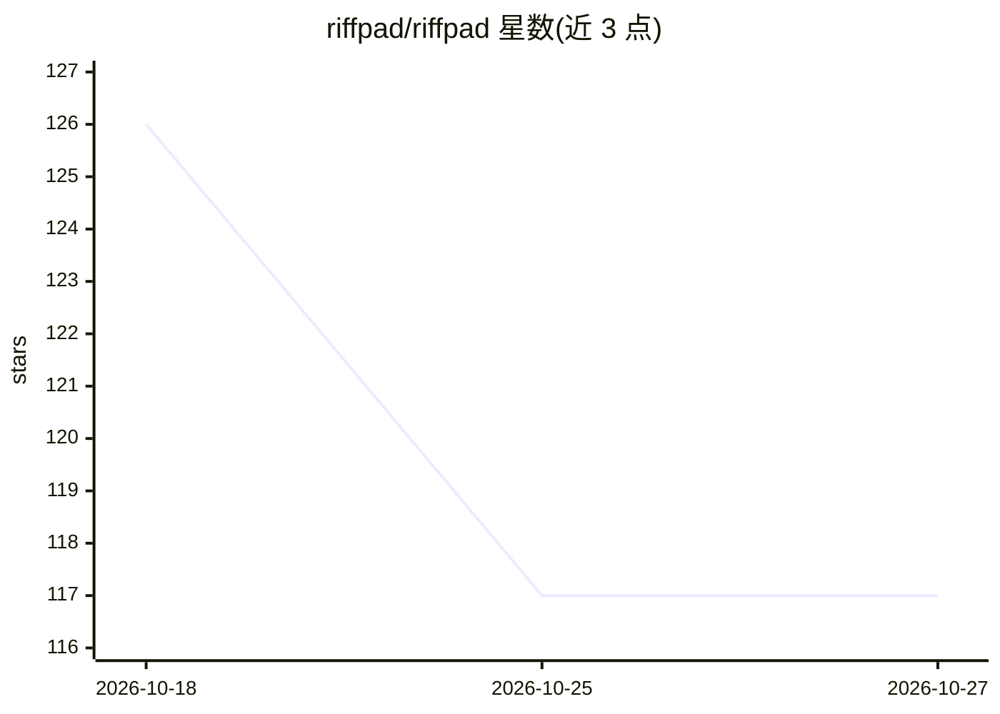

# riffpad/riffpad

⭐ 117 · Go · Apache-2.0 · 推送 2026-10-21 · [GitHub](https://github.com/riffpad/riffpad) · [官网](https://riffpad.ai) · 组织维护 · 中文 README

**从手机远程监控与批准 AI 编程 CLI 会话的工具**

在电脑上运行守护进程，解析各 AI 编程 CLI（Claude Code、Codex、DeepSeek、Kimi 等）的结构化输出，通过零知识加密中继把会话事件流式推送到手机 PWA 应用：手机端可实时观看 agent 输出、一键批准/拒绝权限请求、发送指令回到终端。端到端加密（X25519 + AES-256-GCM），密钥只存在于本机与手机，中继仅转发密文。安装方式为 curl/PowerShell 脚本，经 GitHub 授权登录与配对码绑定手机。CLI 支持英文与中文。

## 筛选速览

| 维度 | 判定 | 备注 |
|---|---|---|
| AI 角色 | `ai-ecosystem` | LLM/agent 周边工具 |
| 许可风险 | `permissive` | Apache-2.0 |
| 部署形态 | `None` |  |
| 模型依赖 | — | README 未给出锁定关系 |
| 硬件要求 | — | 无带数字的原话,不猜 |
| 安装摩擦 | `low` | 无编译、无系统依赖或容器化 |
| 成熟度 | — | 结构信号不足 |

## 能力要点

- 适配多个 AI 编程 CLI（Claude Code、Codex、DeepSeek、Kimi 等）的统一事件流
- 手机端实时观看、一键批准权限、发送指令
- 零知识中继 + X25519/AES-256-GCM 端到端加密，密钥不离开设备
- 本地优先：代码、仓库与 API key 不离开本机

## 适用场景

- 长任务重构时离开工位，用手机跟进 agent 进度
- 在手机上批准 Bash 命令等权限请求，让 agent 继续
- 远程向运行中的 CLI 会话追加指令

## 场景标签

 · 领域:开发者工具/AI agent 管理

## 证据(README 行号)

> L3: **Watch, approve, and steer Claude Code, Codex, and other AI coding CLIs from your phone — without staying chained t
> L96: - **Adapter** — parses each CLI's structured output and hooks into a unified event stream (Claude Code, Codex, Deep
> L98: - **Relay** — lightweight encrypted WebSocket relay. Zero-knowledge: it routes ciphertext and stores nothing.

## 星数曲线

2026-10-18 126 → 2026-10-27 117（-9）

---
*卡片 v1 · prompt 1.4 · 生成 2026-10-23 · 置信度 high · 依据 README sha `6946f9d04e1f` · [字段定义](../../DATASET.md)*
