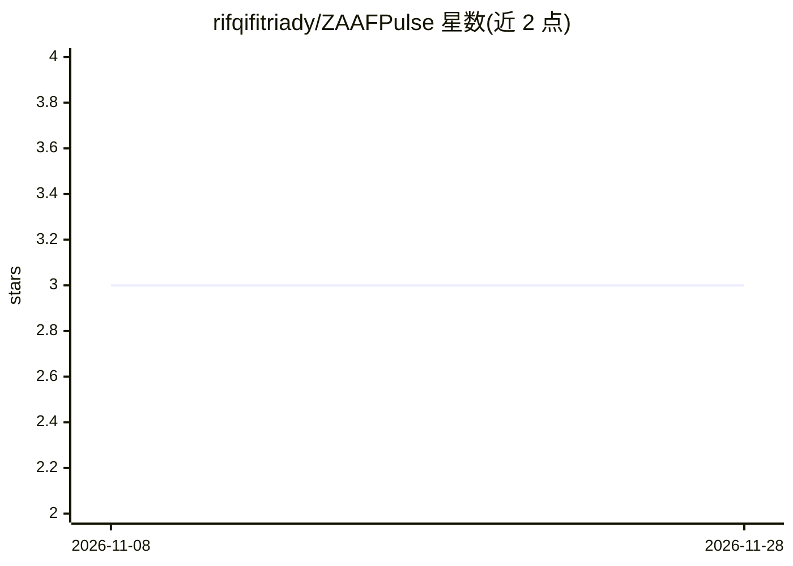

# rifqifitriady/ZAAFPulse

⭐ 3 · JavaScript · MIT · 推送 2026-11-24 · [GitHub](https://github.com/rifqifitriady/ZAAFPulse) · 个人维护

**面向开发者的 AI coding agent 可观测面板与模型网关**

本地优先的桌面/服务器应用，读取 Claude Code 与 Codex 在磁盘上的会话日志，提供用量、成本（按厂商牌价核算）、工具调用准确率、安全事件（提示注入、密钥泄露、危险命令）与 3D 拓扑视图；内含 beta 版 Agent Gateway，提供 OpenAI/Anthropic/Responses/Gemini 兼容端点并预设 52 个 provider，配 MCP server、17 个领域 agent、24 个工作流、RAG 与 A2A。支持监控告警、预算阻断、本地 evals 与 OpenTelemetry 导出。

## 筛选速览

| 维度 | 判定 | 备注 |
|---|---|---|
| AI 角色 | `ai-ecosystem` | LLM/agent 周边工具 |
| 许可风险 | `permissive` | MIT |
| 部署形态 | `self-host` | docker 或自建部署 |
| 模型依赖 | local-ok | 支持本地模型 |
| 硬件要求 | — | 无带数字的原话,不猜 |
| 安装摩擦 | `low` | 无编译、无系统依赖或容器化 |
| 成熟度 | — | 结构信号不足 |

## 能力要点

- 读取 Claude Code/Codex 本地日志，核算成本与准确率，无需上传数据
- Agent Gateway（beta）：OpenAI/Anthropic/Gemini 端点翻译，52 个 provider 预设与 fallback 路由
- MCP server 对接 10+ 客户端，含 17 个 agent、A2A、工作流与 RAG 服务
- 预算可告警、阻断网关请求或暂停 agent，支持 webhook 与桌面通知

## 适用场景

- 查看自己用 Claude Code/Codex 花了多少钱、模型表现如何
- 给团队或客户的 API 使用按成本中心出月度报告
- 让本地的 Claude Code、Cursor 等工具通过一个网关接入多家模型
- 监控 agent 是否出现工具循环、卡死或不安全命令

## 场景标签

`模型网关` `LLM 可观测性` · 领域:Agent 开发

## 证据(README 行号)

> L15: **One command center for everything AI does on your laptop or server:**
> L17: plus an agentic workspace (beta): one API for your models, 17 agents that work together, workflows, RAG, MCP and A2
> L37: |**⌁**|*Can my apps and coding tools use any model through one API?*|An Agent Gateway (beta) on 127.0.0.1: API keys

## 星数曲线

2026-11-08 3 → 2026-11-28 3（+0）

---
*卡片 v1 · prompt 1.4 · 生成 2026-11-21 · 置信度 high · 依据 README sha `e34b3680b93b` · [字段定义](../../DATASET.md)*
