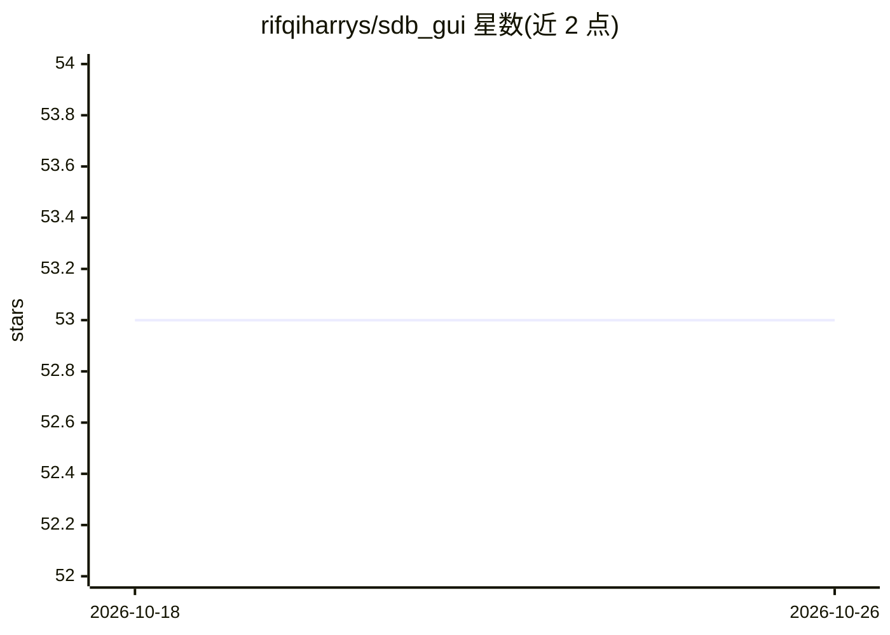

# rifqiharrys/sdb_gui

⭐ 53 · Python · MIT · 推送 2026-08-24 · [GitHub](https://github.com/rifqiharrys/sdb_gui) · 个人维护

**卫星测深 GUI：用卫星影像与深度样本预测水深**

基于 PyQt5 的卫星测深（SDB）桌面软件，面向不具备编程能力的用户：读入 GeoTIFF 多波段影像与 ESRI Shapefile 深度样本，经经验方法（K-近邻、多元线性回归、随机森林）训练模型并生成水深预测，可保存结果。自 v4 起数据处理与预测移入独立 sdb 包，可脱离 GUI 使用。提供 Windows 可执行文件，源码运行依赖 conda/pixi 环境及 numpy、scikit-learn 等包；支持深度限值窗口、属性选择划分训练/测试数据。

## 筛选速览

| 维度 | 判定 | 备注 |
|---|---|---|
| AI 角色 | `ai-native` | 本体是模型或模型工具 |
| 许可风险 | `permissive` | MIT |
| 部署形态 | `desktop` | 安装包/桌面程序 |
| 模型依赖 | — | README 未给出锁定关系 |
| 硬件要求 | — | 无带数字的原话,不猜 |
| 安装摩擦 | `low` | 无编译、无系统依赖或容器化 |
| 成熟度 | — | 结构信号不足 |

## 能力要点

- 读入 GeoTIFF 影像与 Shapefile 深度样本，GUI 完成经验法测深
- 三种回归方法（KNN/多元线性回归/随机森林），可调超参数
- v4 起核心处理逻辑拆分为独立 sdb 包，可脱离 GUI 调用
- 提供 conda/pixi 环境配置文件与 Windows 可执行版本

## 适用场景

- 无编程基础的用户用卫星影像和实测深度样本生成水深预测
- 海洋测绘/近岸测深工作中批量处理多波段影像
- 在脚本或 Notebook 中复用 sdb 包做测深处理

## 场景标签

`数据分析` · 领域:效率与自动化

## 证据(README 行号)

> L9: Mainly, there are two types of methods to create a bathymetric prediction using satellite imagery. Two of which are 
> L11: There are not many GUI (Graphical User Interface) based software to predict bathymetric depth using satellite image
> L156: Next, select your desired regression method. There are three options to select, which are K-Nearest Neighbors, Mul

## 星数曲线

2026-10-18 53 → 2026-10-26 53（+0）

---
*卡片 v1 · prompt 1.4 · 生成 2026-10-24 · 置信度 high · 依据 README sha `6c9377d90869` · [字段定义](../../DATASET.md)*
