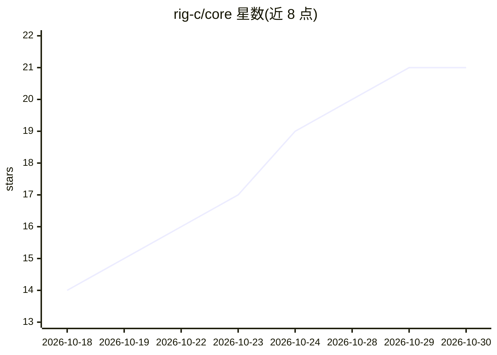

# rig-c/core

⭐ 21 · TypeScript · NOASSERTION · 推送 2026-10-29 · [GitHub](https://github.com/rig-c/core) · [官网](https://rig-c.org) · 个人维护

**供 AI agent 编写并自检 2D 骨骼绑定（Spine 4.3）的编译器**

rigc 是一个绑定（rig）编译器：输入绑定规格与动作规格，输出 Spine 4.3 格式的 skeleton.json 与 skeleton.atlas，可载入任何 Spine 运行时并导入 Spine 编辑器。核心机制是在写出任何字节前运行约 50 条命名断言做验证门（CI 中以 spine-core 往返测试校准），失败则不落盘。定位为 agent skill，供 AI agent 编写绑定并自检成果，再由人类在编辑器中精修。以 npm 包（rig-c）分发，运行需 Bun >=1.4.0；包本身不链接 Spine 运行时。

## 筛选速览

| 维度 | 判定 | 备注 |
|---|---|---|
| AI 角色 | `ai-ecosystem` | LLM/agent 周边工具 |
| 许可风险 | `none` | NOASSERTION |
| 部署形态 | `library` | 以包/库形式分发 |
| 模型依赖 | — | README 未给出锁定关系 |
| 硬件要求 | — | 无带数字的原话,不猜 |
| 安装摩擦 | `low` | 无编译、无系统依赖或容器化 |
| 成熟度 | — | 结构信号不足 |

## 能力要点

- 编译 rig spec 为 Spine 4.3 skeleton.json + skeleton.atlas，可导入 Spine 编辑器
- 写出前运行命名断言验证门，失败即不落盘（CI 以 spine-core 往返测试校准）
- 提供 build/render/inspect/preview/vote/pose 等 CLI 子命令
- 以 agent skill 形式分发，npm 包名为 rig-c（spine-rigc、@rig-c/core 为同一包别名）

## 适用场景

- 让 AI agent 编写 2D 角色绑定并自动验证输出正确性
- 将散件 PNG 组装为可呼吸/眨眼/挥手的 Spine 骨骼动画
- AI 起草绑定后交由人类在 Spine 编辑器中精修

## 场景标签

`代码生成` · 领域:编码与开发

## 证据(README 行号)

> L12: repository's CI. Built so AI agents can author rigs and check their own work; it ships
> L13: as an agent skill. On npm it is `rig-c` — the same package as `spine-rigc`, the name it
> L126: The problem rigc is aimed at is narrow. An agent asked to author a rig has no way

## 星数曲线

2026-10-18 14 → 2026-10-30 21（+7）

---
*卡片 v1 · prompt 1.4 · 生成 2026-10-28 · 置信度 high · 依据 README sha `6385858a8e13` · [字段定义](../../DATASET.md)*
